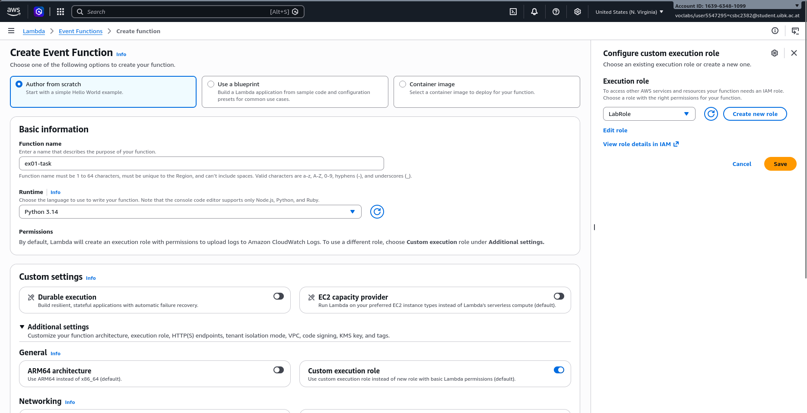
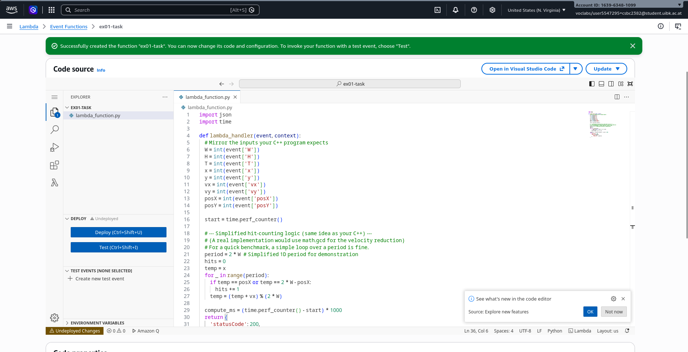

# EX01 Report: Cloud Infrastructure

**Student Name:** David Mairhofer
**Student ID:** `csbc2382`  

---

## Task 1 - Virtual Machines and Baseline Execution

For my local setup (as I didn't want to work in the website-embedded shell), I copied the credentials from learner lab and exported them for terraform and aws cli:
```bash
export AWS_ACCESS_KEY_ID="..."
export AWS_SECRET_ACCESS_KEY="..."
export AWS_SESSION_TOKEN="..."
export AWS_DEFAULT_REGION="us-east-1"
```

Look at the comments in [main.tf](main.tf) for my notes on that. Anyway, the next steps were:
```bash
> terraform init
...
> terraform fmt # nice utility I found
> terraform validate
Success! The configuration is valid.
> terraform plan
... See `plan_output.txt`
> terraform apply
...
Do you want to perform these actions?
  Terraform will perform the actions described above.
  Only 'yes' will be accepted to approve.

  Enter a value: yes

aws_security_group.ssh: Creating...
aws_security_group.ssh: Creation complete after 5s [id=sg-05ba1762c63e33000]
aws_instance.app: Creating...
aws_instance.app: Still creating... [00m10s elapsed]
aws_instance.app: Creation complete after 15s [id=i-0e768a04758efa7fd]

Apply complete! Resources: 2 added, 0 changed, 0 destroyed.

Outputs:

instance_id = "i-0e768a04758efa7fd"
public_ip = "54.159.19.125"

# later; in case I forgot the IP
> terraform output -raw public_ip
54.159.19.125
```

I also downloaded `labuser.pem` from the learner lab AWS Details.

Then I tested the ssh connection:
```bash
ssh -i labsuser.pem ec2-user@54.159.19.125
# look at resources
free -h
#                total        used        free      shared  buff/cache   available
# Mem:           957Mi       158Mi       549Mi       0.0Ki       249Mi       666Mi
# Swap:             0B          0B          0B

sudo dnf install -y gcc-c++ # for later
exit
```
Uploaded my test program (a old program I wrote in a coding competition a few years ago). I computes how many times the DVD logo would hit a corner, given starting position, velocity, the screen dimensions, and how long the simulation runs.
```bash
scp -i labsuser.pem bouncing_dvd.cpp ec2-user@54.159.19.125:~/
scp -i labsuser.pem bouncing_script.sh ec2-user@54.159.19.125:~/
# ... connect, run script, exit
scp -i labsuser.pem ec2-user@54.159.19.125:~/results.csv .
```

You can see the results in [results.csv](results.csv)

---

## Task 2 - Containerization with Docker

First I need to install docker on the instance.
```bash
# connect with ssh
sudo dnf update -y
sudo dnf install -y docker gcc-c++ make
sudo systemctl enable --now docker
sudo usermod -aG docker ec2-user
# disconnect and reconnect for new session
docker run hello-world # classic docker test
```
Then I wrote `dockerfile`, which should be pretty self-explanatory:
```dockerfile
FROM amazonlinux:2023
RUN dnf install -y gcc-c++ && dnf clean all
WORKDIR /app
COPY bouncing_dvd.cpp .
RUN g++ -O2 -std=c++17 -o solver bouncing_dvd.cpp
ENTRYPOINT ["./solver"]
```
And ran it on the instance:
```bash
scp -i labsuser.pem dockerfile ec2-user@54.159.19.125:~/
# ... connect
docker build -t cpp-solver . # tagged as cpp-solver
docker images cpp-solver # check
# testing whether it works:
# (--rm removes the container afterward and -i keeps stdin/out open)
cat > extreme.txt <<'EOF'
100000000 1000 10000000000
0 0 1 
1 50000000 500
EOF
# host baseline
g++ -O2 -std=c++17 -o solver bouncing_dvd.cpp
/usr/bin/time -f "host     wall=%e s  rss=%M KB" ./solver < extreme.txt > /dev/null
# container
/usr/bin/time -f "container wall=%e s  rss=%M KB" \
  docker run --rm -i cpp-solver < extreme.txt > /dev/null
# 1.257 vs 1.621, so ~0.35s overhead for starting the docker
```

2 containers in parallel (as asked in the exercise):
```bash
# -v to mount the file and sh -c './solver ...' runs the string as shell command; overrides the entrypoint in dockerfile
docker run -d --name s1 \
  -v $PWD/extreme.txt:/in.txt:ro \
  --entrypoint sh cpp-solver -c './solver < /in.txt'
docker run -d --name s2 \
  -v $PWD/extreme.txt:/in.txt:ro \
  --entrypoint sh cpp-solver -c './solver < /in.txt'
docker stats --no-stream # print resource stats
docker ps -a # see container states
docker logs s1 # result that got printed
docker logs s2 # result
docker rm s1 s2 # clean up exited containers
```

## Task 3 - Serverless Offloading with AWS Lambda

I made a really simple version of my dvd problem as a lambda function in python (`lambda_function.py`).

I created the lambda function using the web interface as I had no idea how else to do it:



After downloading the required packages (boto3 etc) and uploading `invoke_lambda.py` with scp, it times out (default timeout was 3 seconds). So this is where aws-cli came in handy: I set the timeout to 30s:

```bash
aws lambda update-function-configuration \
  --function-name ex01-task \
  --timeout 30 \
  --region us-east-1
```

and finally got this output:
```
Invoking Lambda with payload: {"W": 500000, "H": 500001, "T": 100000000000, "x": 0, "y": 0, "vx": 1, "vy": 1, "posX": 250000, "posY": 250000}
Total round-trip (EC2 to Lambda): 3075.18 ms
Internal Lambda compute time:   3039.22 ms
Overhead (Network + Cold Start): 35.97 ms
```
Running it multiple times, I didn't notice a significant speedup.

Running the same simple logic with the same inputs on the instane using `local_task.py` surprisinly gave me `163.38ms`, so 20x faster computation (excluding the networking overhead etc; just my own made timing in the identical compute and lambda function). This shows that lambda functions don't individually receive a lot of resources. I think this makes sense, as you probably will have a lot of lambda function calls in parallel, and all those need to share the same resources, while on the node, there was nothing running other than my python script (and ssh connection / standard daemons).

## Discussion Questions

>Question 1: What are the primary benefits of containerizing your application with Docker compared to deploying directly onto a raw EC2 virtual machine?

I get a clean machine and can pick exactly what dependencies I want. So if my program runs in the container defined by my dockerfile, that container will also work on another's machine.

>Why is running multiple containers in parallel on a single VM more efficient or manageable than running multiple raw Python processes manually?

Docker cli gives good tools to manage them (port forwarding etc) and in containers the programs are isolated and won't break each other as easily.

>What are the operational trade-offs between managing code execution on an EC2 VM versus offloading it to a serverless function like AWS Lambda? What did you observe regarding startup times or execution overhead?

The serverless function is always an invocation of a service, which introduces latency. An advantage is that the resources aren't always allocated (like they would be if I have a permanently running process/container). My application example was computationally intensive enough that I didn't notice the startup time (as it was only a python function I'm guessing startup is easy/fast).