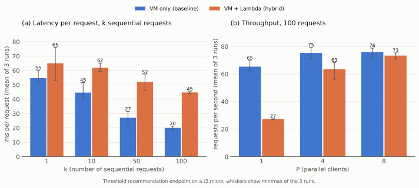

# 1

## 1.1
created main.tf

logged into AWS academy

started the Lab instance

placed my credentials from details into ~/.aws/credentials
(done every session)

terraform init

terraform plan -out=tfplan

terraform apply tfplan

## 1.2

logged into the VM via SSH, and installed docker

```
(base) mauritsvanstaalduinen@Mauritss-MacBook-Air mvs % ssh ec2-user@34.227.84.90

** WARNING: connection is not using a post-quantum key exchange algorithm.
** This session may be vulnerable to "store now, decrypt later" attacks.
** The server may need to be upgraded. See https://openssh.com/pq.html
   ,     #_
   ~\_  ####_        Amazon Linux 2023
  ~~  \_#####\
  ~~     \###|
  ~~       \#/ ___   https://aws.amazon.com/linux/amazon-linux-2023
   ~~       V~' '->
    ~~~         /
      ~~._.   _/
         _/ _/
       _/m/'
```

docker

```
[ec2-user@ip-172-31-40-104 ~]$ sudo dnf install -y docker
Amazon Linux 2023 Kernel Livepatch repository                                                                                                781 kB/s |  89 kB     00:00    
Dependencies resolved.
=============================================================================================================================================================================
 Package                                         Architecture                    Version                                          Repository                            Size
=============================================================================================================================================================================
Installing:
 docker                                          x86_64                          25.0.16-1.amzn2023.0.4                           amazonlinux                           46 M
Installing dependencies:
 container-selinux                               noarch                          4:2.245.0-1.amzn2023                             amazonlinux                           58 k
 containerd                                      x86_64                          2.2.7-1.amzn2023.0.1                             amazonlinux                           25 M
 iptables-libs                                   x86_64                          1.8.8-3.amzn2023.0.2                             amazonlinux                          401 k
 iptables-nft                                    x86_64                          1.8.8-3.amzn2023.0.2                             amazonlinux                          183 k
 libcgroup                                       x86_64                          3.0-1.amzn2023.0.1                               amazonlinux                           75 k
 libnetfilter_conntrack                          x86_64                          1.0.8-2.amzn2023.0.2                             amazonlinux                           58 k
 libnfnetlink                                    x86_64                          1.0.1-19.amzn2023.0.2                            amazonlinux                           30 k
 libnftnl                                        x86_64                          1.2.2-2.amzn2023.0.2                             amazonlinux                           84 k
 pigz                                            x86_64                          2.5-1.amzn2023.0.4                               amazonlinux                           83 k
 runc                                            x86_64                          1.3.6-1.amzn2023.0.1                             amazonlinux                          4.0 M

Transaction Summary
=============================================================================================================================================================================
Install  11 Packages
```

## 1.3

benchmark script bench.sh, runs on the VM against http://localhost:8080 (so no network latency from my laptop)

```
scp bench.sh ec2-user@34.227.84.90:~/
ssh ec2-user@34.227.84.90 './bench.sh'
```

wall-clock time from bash time, 3 runs per configuration, after 40 warm-up requests (JIT, DB connection pool)

setup: t2.micro (1 vCPU, 1 GB RAM), Amazon Linux 2023, app + Postgres 16 in docker, 28,800 seeded measurements (40 sensors x ~720 hourly values = 30 days)

exp 1, depth: department dashboard, 20 sequential requests, days = history aggregated

| days | run 1 | run 2 | run 3 | mean (s) | per request (ms) |
|---|---|---|---|---|---|
| 1  | 0.997 | 0.912 | 0.846 | 0.918 | 46 |
| 3  | 0.907 | 0.802 | 0.772 | 0.827 | 41 |
| 7  | 0.934 | 0.843 | 0.883 | 0.887 | 44 |
| 14 | 1.231 | 1.180 | 1.150 | 1.187 | 59 |
| 30 | 2.099 | 2.041 | 1.742 | 1.961 | 98 |

exp 2, workload size: fetch all measurements of k sensors (~720 rows / ~71 KB JSON each)

| k sensors | run 1 | run 2 | run 3 | mean (s) |
|---|---|---|---|---|
| 1  | 0.025 | 0.020 | 0.030 | 0.025 |
| 5  | 0.118 | 0.101 | 0.117 | 0.112 |
| 10 | 0.187 | 0.193 | 0.181 | 0.187 |
| 20 | 0.319 | 0.342 | 0.395 | 0.352 |
| 40 | 0.704 | 0.622 | 0.586 | 0.637 |

exp 3, concurrency: 200 requests (one sensor), P parallel clients

| P | run 1 | run 2 | run 3 | mean (s) | throughput (req/s) |
|---|---|---|---|---|---|
| 1  | 2.949 | 2.773 | 2.917 | 2.880 | 69 |
| 2  | 2.572 | 2.559 | 2.512 | 2.548 | 78 |
| 4  | 2.489 | 2.620 | 2.463 | 2.524 | 79 |
| 8  | 2.499 | 2.461 | 2.421 | 2.460 | 81 |
| 16 | 2.561 | 2.534 | 2.548 | 2.548 | 78 |

exp 1: up to ~7 days the time is roughly constant (fixed overhead: auth, JPA, serialization), after that it grows with the history aggregated (30 days ~2x the 1 day time)

exp 2: time scales roughly linearly with the rows returned (~16 ms per sensor / 720 rows)

exp 3: 1 to 2 clients gives ~13% more throughput (overlapping I/O waits), then it plateaus at ~80 req/s because the single vCPU is saturated, more concurrency only adds queueing


# 2

## 2.1/2.2

logged into the new instance and installed docker

```
ssh ec2-user@184.73.43.150
sudo dnf install -y docker
sudo systemctl enable --now docker
sudo usermod -aG docker ec2-user
exit
```

recompiled SE project for amd64, and sent it to the instance

```
docker buildx build --platform linux/amd64 -t g6t3-app:amd64 .
docker save g6t3-app:amd64 | gzip | ssh ec2-user@184.73.43.150 'gunzip | docker load'
```

ssh ec2-user@184.73.43.150

created the docker network the containers use to find each other, and started my database

```
docker run -d --name postgres --network appnet \
  -e POSTGRES_DB=skeleton_db \
  -e POSTGRES_USER=skeleton_user \
  -e POSTGRES_PASSWORD=changeme \
  postgres:16
```

started my backend

```
docker run -d --name app --network appnet -p 8080:8080 \
  -e DB_HOST=postgres \
  -e DB_NAME=skeleton_db \
  -e DB_USERNAME=skeleton_user \
  -e DB_PASSWORD=changeme \
  -e APP_JWT_SECRET=$(openssl rand -base64 48) \
  g6t3-app:amd64
```

docker logs -f app

copied the SQL file from my laptop to the instance

scp data.sql ec2-user@34.227.84.90:~/data.sql

ssh ec2-user@34.227.84.90

removed line 83 (SET NOT NULL, conflicts with the prod schema)

sed "83d" ~/data.sql > ~/data_prod.sql

copied the file into the postgres container so psql can read it

docker cp ~/data_prod.sql postgres:/tmp/data_prod.sql

seeded the database in a single transaction (an error rolls back everything)

docker exec postgres psql -U skeleton_user -d skeleton_db -v ON_ERROR_STOP=1 --single-transaction -f /tmp/data_prod.sql

checked the seed loaded (23 users)

docker exec postgres psql -U skeleton_user -d skeleton_db -c "select count(*) from userx;"

login failed, the app log showed the JWT key was too short

docker exec app sh -c "grep -E 'ERROR|Exception' /app/logs/app.log | tail"

removed the app container (database keeps running with its data)

docker rm -f app

started the app again with a random 512-bit JWT secret

```
docker run -d --name app --network appnet -p 8080:8080 \
  -e DB_HOST=postgres -e DB_NAME=skeleton_db -e DB_USERNAME=skeleton_user -e DB_PASSWORD=changeme \
  -e APP_JWT_SECRET=$(openssl rand -base64 64 | tr -d "\n") \
  --restart unless-stopped g6t3-app:amd64
```

forwarded port 8080, because the frontend has localhost:8080 hard coded

ssh -N -L 8080:localhost:8080 ec2-user@34.227.84.90

changed the server URL in api-docs.json from http://localhost:8080 to /

app runs on http://localhost:8080 (tunnel) and http://34.227.84.90:8080

logs

```
(base) mauritsvanstaalduinen@Mauritss-MacBook-Air mvs % ssh ec2-user@34.227.84.90

** WARNING: connection is not using a post-quantum key exchange algorithm.
** This session may be vulnerable to "store now, decrypt later" attacks.
** The server may need to be upgraded. See https://openssh.com/pq.html
   ,     #_
   ~\_  ####_        Amazon Linux 2023
  ~~  \_#####\
  ~~     \###|
  ~~       \#/ ___   https://aws.amazon.com/linux/amazon-linux-2023
   ~~       V~' '->
    ~~~         /
      ~~._.   _/
         _/ _/
       _/m/'
Last login: Sat Oct 10 18:27:41 2026 from 209.198.159.79
[ec2-user@ip-172-31-41-118 ~]$ docker logs -f app

  .   ____          _            __ _ _
 /\\ / ___'_ __ _ _(_)_ __  __ _ \ \ \ \
( ( )\___ | '_ | '_| | '_ \/ _` | \ \ \ \
 \\/  ___)| |_)| | | | | || (_| |  ) ) ) )
  '  |____| .__|_| |_|_| |_\__, | / / / /
 =========|_|==============|___/=/_/_/_/

 :: Spring Boot ::               (v3.5.11)

2026-10-10 19:39:50 [INFO ] [at.qe.skeleton.Main] Starting Main v2.1 using Java 25.0.4.1 with PID 1 (/app/app.jar started by appuser in /app)
2026-10-10 19:39:50 [INFO ] [at.qe.skeleton.Main] The following 1 profile is active: "prod"
2026-10-10 19:39:53 [INFO ] [o.s.d.r.c.RepositoryConfigurationDelegate] Bootstrapping Spring Data JPA repositories in DEFAULT mode.
2026-10-10 19:39:53 [INFO ] [o.s.d.r.c.RepositoryConfigurationDelegate] Finished Spring Data repository scanning in 224 ms. Found 13 JPA repository interfaces.
2026-10-10 19:39:55 [INFO ] [o.s.b.w.e.tomcat.TomcatWebServer] Tomcat initialized with port 8080 (http)
2026-10-10 19:39:55 [INFO ] [o.a.coyote.http11.Http11NioProtocol] Initializing ProtocolHandler ["http-nio-8080"]
2026-10-10 19:39:55 [INFO ] [o.a.catalina.core.StandardService] Starting service [Tomcat]
2026-10-10 19:39:55 [INFO ] [o.a.catalina.core.StandardEngine] Starting Servlet engine: [Apache Tomcat/10.1.52]
2026-10-10 19:39:55 [INFO ] [o.a.c.c.C.[Tomcat].[localhost].[/]] Initializing Spring embedded WebApplicationContext
2026-10-10 19:39:55 [INFO ] [o.s.b.w.s.c.ServletWebServerApplicationContext] Root WebApplicationContext: initialization completed in 5401 ms
2026-10-10 19:39:56 [INFO ] [com.zaxxer.hikari.HikariDataSource] HikariPool-1 - Starting...
2026-10-10 19:39:57 [INFO ] [com.zaxxer.hikari.pool.HikariPool] HikariPool-1 - Added connection org.postgresql.jdbc.PgConnection@cb318ac
2026-10-10 19:39:57 [INFO ] [com.zaxxer.hikari.HikariDataSource] HikariPool-1 - Start completed.
2026-10-10 19:39:57 [INFO ] [o.h.jpa.internal.util.LogHelper] HHH000204: Processing PersistenceUnitInfo [name: default]
2026-10-10 19:39:57 [INFO ] [org.hibernate.Version] HHH000412: Hibernate ORM core version 6.6.42.Final
2026-10-10 19:39:57 [INFO ] [o.h.c.i.RegionFactoryInitiator] HHH000026: Second-level cache disabled
2026-10-10 19:39:58 [INFO ] [o.s.o.j.p.SpringPersistenceUnitInfo] No LoadTimeWeaver setup: ignoring JPA class transformer
2026-10-10 19:39:58 [WARN ] [org.hibernate.orm.deprecation] HHH90000025: PostgreSQLDialect does not need to be specified explicitly using 'hibernate.dialect' (remove the property setting and it will be selected by default)
2026-10-10 19:39:58 [INFO ] [o.hibernate.orm.connections.pooling] HHH10001005: Database info:
        Database JDBC URL [Connecting through datasource 'HikariDataSource (HikariPool-1)']
        Database driver: undefined/unknown
        Database version: 16.15
        Autocommit mode: undefined/unknown
        Isolation level: undefined/unknown
        Minimum pool size: undefined/unknown
        Maximum pool size: undefined/unknown
2026-10-10 19:40:00 [INFO ] [o.h.validator.internal.util.Version] HV000001: Hibernate Validator 8.0.3.Final
2026-10-10 19:40:02 [INFO ] [o.h.e.t.j.p.i.JtaPlatformInitiator] HHH000489: No JTA platform available (set 'hibernate.transaction.jta.platform' to enable JTA platform integration)
2026-10-10 19:40:03 [INFO ] [o.s.o.j.LocalContainerEntityManagerFactoryBean] Initialized JPA EntityManagerFactory for persistence unit 'default'
2026-10-10 19:40:04 [INFO ] [o.s.d.j.r.query.QueryEnhancerFactory] Hibernate is in classpath; If applicable, HQL parser will be used.
Start time is in the past: 2026-10-09T00:00:00Z
Start time is in the past: 2026-09-10T00:00:00Z
Office Operations Hub occupancy changed. Occupancy: 1
Office Operations Hub occupancy changed. Occupancy: 1
Office Server Room C1 occupancy changed. Occupancy: 0
2026-10-10 19:40:07 [INFO ] [o.s.s.c.a.a.c.InitializeUserDetailsBeanManagerConfigurer$InitializeUserDetailsManagerConfigurer] Global AuthenticationManager configured with UserDetailsService bean with name userxService
2026-10-10 19:40:08 [WARN ] [o.s.b.a.o.j.JpaBaseConfiguration$JpaWebConfiguration] spring.jpa.open-in-view is enabled by default. Therefore, database queries may be performed during view rendering. Explicitly configure spring.jpa.open-in-view to disable this warning
2026-10-10 19:40:08 [INFO ] [o.s.b.a.w.s.WelcomePageHandlerMapping] Adding welcome page: class path resource [static/index.html]
2026-10-10 19:40:09 [INFO ] [o.s.b.a.e.web.EndpointLinksResolver] Exposing 1 endpoint beneath base path '/actuator'
2026-10-10 19:40:10 [INFO ] [o.a.coyote.http11.Http11NioProtocol] Starting ProtocolHandler ["http-nio-8080"]
2026-10-10 19:40:10 [INFO ] [o.s.b.w.e.tomcat.TomcatWebServer] Tomcat started on port 8080 (http) with context path '/'
2026-10-10 19:40:10 [INFO ] [at.qe.skeleton.Main] Started Main in 21.738 seconds (process running for 23.092)
2026-10-10 19:40:11 [WARN ] [o.s.c.events.SpringDocAppInitializer] SpringDoc /api-docs endpoint is enabled by default. To disable it in production, set the property 'springdoc.api-docs.enabled=false'
2026-10-10 19:40:12 [INFO ] [o.a.c.c.C.[Tomcat].[localhost].[/]] Initializing Spring DispatcherServlet 'dispatcherServlet'
2026-10-10 19:40:12 [INFO ] [o.s.web.servlet.DispatcherServlet] Initializing Servlet 'dispatcherServlet'
2026-10-10 19:40:12 [INFO ] [o.s.web.servlet.DispatcherServlet] Completed initialization in 2 ms
```

## 2.3

checked that there are 2 instances (one running, the old one terminated)

aws ec2 describe-instances --output table

```
------------------------------------------------------------------------------
|                              DescribeInstances                             |
+----------------------------------------------------------------------------+
||                               Reservations                               ||
|+------------------------------+-------------------------------------------+|
||  OwnerId                     |  764682592510                             ||
||  ReservationId               |  r-050c43b751b0d1b95                      ||
|+------------------------------+-------------------------------------------+|
|||                                Instances                               |||
||+---------------------------+--------------------------------------------+||
|||  AmiLaunchIndex           |  0                                         |||
|||  Architecture             |  x86_64                                    |||
|||  BootMode                 |  uefi-preferred                            |||
|||  ClientToken              |  terraform-FAK4NQedL0By1wva95E4AyBP7T      |||
|||  CurrentInstanceBootMode  |  legacy-bios                               |||
|||  EbsOptimized             |  False                                     |||
|||  EnaSupport               |  True                                      |||
|||  Hypervisor               |  xen                                       |||
|||  ImageId                  |  ami-03c3da4cfa8e8943a                     |||
|||  InstanceId               |  i-0b13b1b56420c34c8                       |||
|||  InstanceType             |  t2.micro                                  |||
|||  KeyName                  |  terraform-786eadee50a15d8e0d06b503a2      |||
|||  LaunchTime               |  2026-10-10T16:48:28+00:00                 |||
|||  PlatformDetails          |  Linux/UNIX                                |||
|||  PrivateDnsName           |  ip-172-31-41-118.ec2.internal             |||
|||  PrivateIpAddress         |  172.31.41.118                             |||
|||  PublicDnsName            |  ec2-34-227-84-90.compute-1.amazonaws.com  |||
|||  PublicIpAddress          |  34.227.84.90                              |||
|||  RootDeviceName           |  /dev/xvda                                 |||
|||  RootDeviceType           |  ebs                                       |||
|||  SourceDestCheck          |  True                                      |||
|||  StateTransitionReason    |                                            |||
|||  SubnetId                 |  subnet-0f228ea8bfe22293b                  |||
|||  UsageOperation           |  RunInstances                              |||
|||  UsageOperationUpdateTime |  2026-10-10T16:48:28+00:00                 |||
|||  VirtualizationType       |  hvm                                       |||
|||  VpcId                    |  vpc-0653b48281d0e6adc                     |||
||+---------------------------+--------------------------------------------+||
||||                          BlockDeviceMappings                         ||||
|||+-----------------------------------+----------------------------------+|||
||||  DeviceName                       |  /dev/xvda                       ||||
|||+-----------------------------------+----------------------------------+|||
|||||                                 Ebs                                |||||
||||+-----------------------------+--------------------------------------+||||
|||||  AttachTime                 |  2026-10-10T16:48:28+00:00           |||||
|||||  DeleteOnTermination        |  True                                |||||
|||||  EbsCardIndex               |  0                                   |||||
|||||  Status                     |  attached                            |||||
|||||  VolumeId                   |  vol-0d10cee4e09d8079d               |||||
||||+-----------------------------+--------------------------------------+||||
||||                   CapacityReservationSpecification                   ||||
|||+--------------------------------------------------------+-------------+|||
||||  CapacityReservationPreference                         |  open       ||||
|||+--------------------------------------------------------+-------------+|||
||||                              CpuOptions                              ||||
|||+------------------------------------------------------+---------------+|||
||||  CoreCount                                           |  1            ||||
||||  ThreadsPerCore                                      |  1            ||||
|||+------------------------------------------------------+---------------+|||
||||                            EnclaveOptions                            ||||
|||+--------------------------------------+-------------------------------+|||
||||  Enabled                             |  False                        ||||
|||+--------------------------------------+-------------------------------+|||
||||                          HibernationOptions                          ||||
|||+------------------------------------------+---------------------------+|||
||||  Configured                              |  False                    ||||
|||+------------------------------------------+---------------------------+|||
||||                          MaintenanceOptions                          ||||
|||+--------------------------------------------+-------------------------+|||
||||  AutoRecovery                              |  default                ||||
||||  RebootMigration                           |  default                ||||
|||+--------------------------------------------+-------------------------+|||
||||                            MetadataOptions                           ||||
|||+------------------------------------------------+---------------------+|||
||||  HttpEndpoint                                  |  enabled            ||||
||||  HttpProtocolIpv6                              |  disabled           ||||
||||  HttpPutResponseHopLimit                       |  2                  ||||
||||  HttpTokens                                    |  required           ||||
||||  InstanceMetadataTags                          |  disabled           ||||
||||  State                                         |  applied            ||||
|||+------------------------------------------------+---------------------+|||
||||                              Monitoring                              ||||
|||+-----------------------------+----------------------------------------+|||
||||  State                      |  disabled                              ||||
|||+-----------------------------+----------------------------------------+|||
||||                           NetworkInterfaces                          ||||
|||+---------------------------+------------------------------------------+|||
||||  Description              |                                          ||||
||||  InterfaceType            |  interface                               ||||
||||  MacAddress               |  0e:ff:cc:7d:82:d3                       ||||
||||  NetworkInterfaceId       |  eni-07e887cdfb15271e9                   ||||
||||  OwnerId                  |  764682592510                            ||||
||||  PrivateDnsName           |  ip-172-31-41-118.ec2.internal           ||||
||||  PrivateIpAddress         |  172.31.41.118                           ||||
||||  SourceDestCheck          |  True                                    ||||
||||  Status                   |  in-use                                  ||||
||||  SubnetId                 |  subnet-0f228ea8bfe22293b                ||||
||||  VpcId                    |  vpc-0653b48281d0e6adc                   ||||
|||+---------------------------+------------------------------------------+|||
|||||                             Association                            |||||
||||+------------------+-------------------------------------------------+||||
|||||  IpOwnerId       |  amazon                                         |||||
|||||  PublicDnsName   |  ec2-34-227-84-90.compute-1.amazonaws.com       |||||
|||||  PublicIp        |  34.227.84.90                                   |||||
||||+------------------+-------------------------------------------------+||||
|||||                             Attachment                             |||||
||||+---------------------------+----------------------------------------+||||
|||||  AttachTime               |  2026-10-10T16:48:27+00:00             |||||
|||||  AttachmentId             |  eni-attach-045b9f6ebedf798ca          |||||
|||||  DeleteOnTermination      |  True                                  |||||
|||||  DeviceIndex              |  0                                     |||||
|||||  NetworkCardIndex         |  0                                     |||||
|||||  Status                   |  attached                              |||||
||||+---------------------------+----------------------------------------+||||
|||||                               Groups                               |||||
||||+---------------+----------------------------------------------------+||||
|||||  GroupId      |  sg-03a098e13e39810f1                              |||||
|||||  GroupName    |  terraform-20a69c06cd9b74aae4e8467266              |||||
||||+---------------+----------------------------------------------------+||||
|||||                              Operator                              |||||
||||+------------------------------------+-------------------------------+||||
|||||  Managed                           |  False                        |||||
||||+------------------------------------+-------------------------------+||||
|||||                         PrivateIpAddresses                         |||||
||||+------------------------+-------------------------------------------+||||
|||||  Primary               |  True                                     |||||
|||||  PrivateDnsName        |  ip-172-31-41-118.ec2.internal            |||||
|||||  PrivateIpAddress      |  172.31.41.118                            |||||
||||+------------------------+-------------------------------------------+||||
||||||                            Association                           ||||||
|||||+-----------------+------------------------------------------------+|||||
||||||  IpOwnerId      |  amazon                                        ||||||
||||||  PublicDnsName  |  ec2-34-227-84-90.compute-1.amazonaws.com      ||||||
||||||  PublicIp       |  34.227.84.90                                  ||||||
|||||+-----------------+------------------------------------------------+|||||
||||                       NetworkPerformanceOptions                      ||||
|||+----------------------------------------------+-----------------------+|||
||||  BandwidthWeighting                          |  default              ||||
|||+----------------------------------------------+-----------------------+|||
||||                               Operator                               ||||
|||+-----------------------------------------------+----------------------+|||
||||  HiddenByDefault                              |  False               ||||
||||  Managed                                      |  False               ||||
|||+-----------------------------------------------+----------------------+|||
||||                               Placement                              ||||
|||+------------------------------------------+---------------------------+|||
||||  AvailabilityZone                        |  us-east-1d               ||||
||||  AvailabilityZoneId                      |  use1-az6                 ||||
||||  GroupName                               |                           ||||
||||  Tenancy                                 |  default                  ||||
|||+------------------------------------------+---------------------------+|||
||||                         PrivateDnsNameOptions                        ||||
|||+-----------------------------------------------------+----------------+|||
||||  EnableResourceNameDnsAAAARecord                    |  False         ||||
||||  EnableResourceNameDnsARecord                       |  False         ||||
||||  HostnameType                                       |  ip-name       ||||
|||+-----------------------------------------------------+----------------+|||
||||                            SecurityGroups                            ||||
|||+----------------+-----------------------------------------------------+|||
||||  GroupId       |  sg-03a098e13e39810f1                               ||||
||||  GroupName     |  terraform-20a69c06cd9b74aae4e8467266               ||||
|||+----------------+-----------------------------------------------------+|||
||||                                 State                                ||||
|||+----------------------------+-----------------------------------------+|||
||||  Code                      |  16                                     ||||
||||  Name                      |  running                                ||||
|||+----------------------------+-----------------------------------------+|||
||                               Reservations                               ||
|+------------------------------+-------------------------------------------+|
||  OwnerId                     |  764682592510                             ||
||  ReservationId               |  r-0c4ce46c186b3f442                      ||
|+------------------------------+-------------------------------------------+|
|||                                Instances                               |||
||+---------------------------+--------------------------------------------+||
|||  AmiLaunchIndex           |  0                                         |||
|||  Architecture             |  x86_64                                    |||
|||  BootMode                 |  uefi-preferred                            |||
|||  ClientToken              |  terraform-OTIehOFVPJ0fnnyIqcl1K75IfW      |||
|||  CurrentInstanceBootMode  |  legacy-bios                               |||
|||  EbsOptimized             |  False                                     |||
|||  EnaSupport               |  True                                      |||
|||  Hypervisor               |  xen                                       |||
|||  ImageId                  |  ami-03c3da4cfa8e8943a                     |||
|||  InstanceId               |  i-04c99c6b22d7eb4ba                       |||
|||  InstanceType             |  t2.micro                                  |||
|||  KeyName                  |  terraform-32bbefede2b8fdf475551e1bee      |||
|||  LaunchTime               |  2026-10-10T16:37:54+00:00                 |||
|||  PlatformDetails          |  Linux/UNIX                                |||
|||  PrivateDnsName           |                                            |||
|||  PublicDnsName            |                                            |||
|||  RootDeviceName           |  /dev/xvda                                 |||
|||  RootDeviceType           |  ebs                                       |||
|||  StateTransitionReason    |  User initiated (2026-10-10 17:37:45 GMT)  |||
|||  UsageOperation           |  RunInstances                              |||
|||  UsageOperationUpdateTime |  2026-10-10T16:37:54+00:00                 |||
|||  VirtualizationType       |  hvm                                       |||
||+---------------------------+--------------------------------------------+||
||||                   CapacityReservationSpecification                   ||||
|||+--------------------------------------------------------+-------------+|||
||||  CapacityReservationPreference                         |  open       ||||
|||+--------------------------------------------------------+-------------+|||
||||                              CpuOptions                              ||||
|||+------------------------------------------------------+---------------+|||
||||  CoreCount                                           |  1            ||||
||||  ThreadsPerCore                                      |  1            ||||
|||+------------------------------------------------------+---------------+|||
||||                            EnclaveOptions                            ||||
|||+--------------------------------------+-------------------------------+|||
||||  Enabled                             |  False                        ||||
|||+--------------------------------------+-------------------------------+|||
||||                          HibernationOptions                          ||||
|||+------------------------------------------+---------------------------+|||
||||  Configured                              |  False                    ||||
|||+------------------------------------------+---------------------------+|||
||||                          MaintenanceOptions                          ||||
|||+--------------------------------------------+-------------------------+|||
||||  AutoRecovery                              |  default                ||||
||||  RebootMigration                           |  default                ||||
|||+--------------------------------------------+-------------------------+|||
||||                            MetadataOptions                           ||||
|||+------------------------------------------------+---------------------+|||
||||  HttpEndpoint                                  |  enabled            ||||
||||  HttpProtocolIpv6                              |  disabled           ||||
||||  HttpPutResponseHopLimit                       |  2                  ||||
||||  HttpTokens                                    |  required           ||||
||||  InstanceMetadataTags                          |  disabled           ||||
||||  State                                         |  pending            ||||
|||+------------------------------------------------+---------------------+|||
||||                              Monitoring                              ||||
|||+-----------------------------+----------------------------------------+|||
||||  State                      |  disabled                              ||||
|||+-----------------------------+----------------------------------------+|||
||||                       NetworkPerformanceOptions                      ||||
|||+----------------------------------------------+-----------------------+|||
||||  BandwidthWeighting                          |  default              ||||
|||+----------------------------------------------+-----------------------+|||
||||                               Operator                               ||||
|||+-----------------------------------------------+----------------------+|||
||||  HiddenByDefault                              |  False               ||||
||||  Managed                                      |  False               ||||
|||+-----------------------------------------------+----------------------+|||
||||                               Placement                              ||||
|||+------------------------------------------+---------------------------+|||
||||  AvailabilityZone                        |  us-east-1d               ||||
||||  AvailabilityZoneId                      |  use1-az6                 ||||
||||  GroupName                               |                           ||||
||||  Tenancy                                 |  default                  ||||
|||+------------------------------------------+---------------------------+|||
||||                                 State                                ||||
|||+------------------------+---------------------------------------------+|||
||||  Code                  |  48                                         ||||
||||  Name                  |  terminated                                 ||||
|||+------------------------+---------------------------------------------+|||
||||                              StateReason                             ||||
|||+----------+-----------------------------------------------------------+|||
||||  Code    |  Client.UserInitiatedShutdown                             ||||
||||  Message |  Client.UserInitiatedShutdown: User initiated shutdown    ||||
|||+----------+-----------------------------------------------------------+|||
```

# 3

## 3.1

wrote a python lambda for the threshold recommendation service of my webapp: lambda/threshold_lambda.py

used the same percentile method as Apache Commons Math, so the results match the Java app exactly

deployed only the lambda (saves money, no idle EC2 instance)

terraform apply -target=aws_lambda_function_url.threshold -target=aws_lambda_permission.url_invoke -target=aws_lambda_permission.public_invoke

tested the lambda

```
(base) mauritsvanstaalduinen@Mauritss-MacBook-Air mvs % curl -s -X POST "$(terraform output -raw lambda_url)" -H "Content-Type: application/json" \
  -d '{"sensors":[{"sensorId":1,"type":"TEMPERATURE","values":[18,19,20,21,22,23,24,25,26,27,28,29,30,31,32,33,34,35,36,37,38,39,40,41,42,43,44,45,46,47,48,49,50,51,52,53,54,55,56,57,58,59,60,61,62,63,64,65,66,67]}]}'
{"results": [{"sensorId": 1, "type": "TEMPERATURE", "count": 50, "lower": 19.55, "upper": 65.45}], "computeMs": 0.035}%         
```

input: {"sensors":[{"sensorId":30001,"type":"TEMPERATURE","values":[...]}]}

output: {"results":[{"sensorId":30001,"type":"TEMPERATURE","count":168,"lower":16.93,"upper":20.1}],"computeMs":0.03}

lambda is nice because it only charges per call

## 3.2

added a switch to ThresholdRecommendationService (g6t3 repo): if app.threshold.lambda-url is set, it still loads the values from its own database, but sends all sensors of the room in one JSON request to the lambda (Spring RestClient) instead of computing the percentiles locally

without the property it works as before, so the same image runs both variants

rebuilt the image and redeployed (new instance 54.89.167.59), with the lambda URL as env variable

```
docker buildx build --platform linux/amd64 -t g6t3-app:amd64 .
terraform apply
docker save g6t3-app:amd64 | gzip | ssh ec2-user@54.89.167.59 'gunzip | docker load'

# on the new instance: same network, Postgres and seeding as in 2.1/2.2
docker network create appnet
docker run -d --name postgres --network appnet \
  -e POSTGRES_DB=skeleton_db -e POSTGRES_USER=skeleton_user -e POSTGRES_PASSWORD=changeme \
  postgres:16
docker cp ~/data_prod.sql postgres:/tmp/data_prod.sql
docker exec postgres psql -U skeleton_user -d skeleton_db -v ON_ERROR_STOP=1 --single-transaction -f /tmp/data_prod.sql

docker run -d --name app --network appnet -p 8080:8080 \
  -e DB_HOST=postgres -e DB_NAME=skeleton_db -e DB_USERNAME=skeleton_user -e DB_PASSWORD=changeme \
  -e APP_JWT_SECRET=$(openssl rand -base64 64 | tr -d "\n") \
  -e APP_THRESHOLD_LAMBDA_URL=https://flbpl2fdosgbg6w65rre7uui2m0jnrck.lambda-url.us-east-1.on.aws/ \
  -e LOGGING_CONFIG=/config/logback-docker.xml -v ~/logback-docker.xml:/config/logback-docker.xml:ro \
  --restart unless-stopped g6t3-app:amd64
```

tested it as building_manager

```
$ curl -H "Authorization: Bearer $T" http://54.89.167.59:8080/api/rooms/1000/thresholds/recommend
[{"metricType":"TEMPERATURE","upperLimit":20.1,"lowerLimit":16.93},
 {"metricType":"HUMIDITY","upperLimit":60.9,"lowerLimit":48.54},
 {"metricType":"AIR_QUALITY","upperLimit":698.65,"lowerLimit":401.0},
 {"metricType":"PRESSURE","upperLimit":97242.0,"lowerLimit":97168.35}]
room 1000: HTTP 200 1.958s   (cold start)
room 2000: HTTP 200 0.458s   (warm)
```

CloudWatch logs of the lambda

```
16:53:11 INIT_START Runtime Version: python:3.13
16:53:11 REPORT Duration: 10.83 ms  Billed Duration: 112 ms  Memory Size: 128 MB  Max Memory Used: 37 MB  Init Duration: 101.13 ms
16:53:12 REPORT Duration: 2.13 ms   Billed Duration: 3 ms    Memory Size: 128 MB  Max Memory Used: 37 MB
```

## 3.3

benchmark script bench_lambda.sh, runs on the VM against localhost:8080, endpoint GET /api/rooms/{id}/thresholds/recommend (as building_manager, cycling through the 10 rooms, 4 sensors / ~670 values per room)

same image, same instance, same data, only restarted the app container with or without APP_THRESHOLD_LAMBDA_URL

local = baseline, percentiles computed in the Spring app (as in 1)

lambda = hybrid, app loads values from postgres and sends them to the lambda

```
scp bench_lambda.sh ec2-user@54.89.167.59:~/
./bench_lambda.sh local     # app started without APP_THRESHOLD_LAMBDA_URL
./bench_lambda.sh lambda    # app started with APP_THRESHOLD_LAMBDA_URL
```

wall-clock time from bash time, 3 runs per configuration, after 30 warm-up requests (so the lambda is warm)

exp A, k sequential requests

| k | local runs (s) | local mean | lambda runs (s) | lambda mean | per request local / lambda |
|---|---|---|---|---|---|
| 1   | 0.060 0.053 0.051 | 0.055 | 0.066 0.076 0.053 | 0.065 | 55 / 65 ms |
| 10  | 0.419 0.402 0.516 | 0.446 | 0.652 0.611 0.593 | 0.619 | 45 / 62 ms |
| 50  | 1.576 1.325 1.159 | 1.353 | 2.852 2.631 2.308 | 2.597 | 27 / 52 ms |
| 100 | 2.121 2.064 1.815 | 2.000 | 4.528 4.512 4.367 | 4.469 | 20 / 45 ms |

exp B, 100 requests, P parallel clients

| P | local runs (s) | local mean | throughput | lambda runs (s) | lambda mean | throughput |
|---|---|---|---|---|---|---|
| 1 | 1.594 1.565 1.435 | 1.531 | 65 req/s | 3.740 3.649 3.635 | 3.675 | 27 req/s |
| 4 | 1.322 1.262 1.400 | 1.328 | 75 req/s | 1.779 1.466 1.486 | 1.577 | 63 req/s |
| 8 | 1.391 1.270 1.293 | 1.318 | 76 req/s | 1.408 1.328 1.355 | 1.364 | 73 req/s |

graph made with python plot_task3.py (matplotlib), data from the tables above



note: exp A k=100 and exp B P=1 are both 100 sequential requests but disagree (local 2.000 vs. 1.531 s, lambda 4.469 vs. 3.675 s). They were separate benchmark runs and I did not control for the difference; the most likely cause is CPU credit / background-load variation on the t2.micro between runs (see 1.3), which I did not verify. The local-vs-lambda gap is similar in both, so the conclusions below do not depend on it.

(a) the per request latency of the hybrid version is above the baseline by 10 ms at k=1 and 17 ms at k=10, growing to ~25 ms at k=50 and k=100 and then staying there; the HTTPS round trip to the lambda is a per-request cost

(b) with one client the hybrid version only reaches 27 vs. 65 req/s, with 8 parallel clients both converge (~73-76 req/s) because the single vCPU is the bottleneck either way

cold start: first request after deployment 1.96 s vs. ~0.46 s warm

CloudWatch says Init Duration: 101 ms, the rest is most likely connection setup (DNS, TLS) from the app to the function URL plus the app's own first-call costs (RestClient initialization, JIT); I did not measure this split, and the 1.96 s was measured from my laptop, not from localhost

for this workload the hybrid version is slower, sequentially ~2.2x (45 vs. 20 ms per request)

the computation itself is tiny (lambda reports 2-11 ms for 4 sensors, locally sub-millisecond), so the HTTPS round trip to the lambda (~25 ms) takes the longest, offloading only pays off when the computation costs clearly more than the network transfer

under concurrency the gap closes (P=8: 1.36 s vs. 1.32 s, within 3%), the VM is CPU-bound at ~76 req/s, with the lambda the app thread just waits on I/O while the lambda computes, so more clients hide the latency

hypothesis (not tested): with a heavier computation the lambda might overtake the local version once the CPU saturates

cold starts add a one-time penalty (~1.5 s here) that the always-running VM doesn't have

trade-off: VM = constant cost and full control but fixed capacity, lambda = pay per call (here ~3-112 ms billed per call), automatic scaling and no server management, but network latency, cold starts and a 6 MB payload limit per request


# Questions

1. What are the primary benefits of containerizing your application with Docker compared to deploying directly onto a raw EC2 virtual machine?

A: the image has everything the app needs (Java runtime, jar, config), so the VM only needs docker installed, no Java or Postgres setup by hand

same image runs on my laptop and on EC2, built once with docker buildx for amd64 and loaded with docker save / docker load, I built the image for amd64 on my ARM Mac and the same image ran unchanged on EC2

configuration is passed as env variables (DB_HOST, APP_JWT_SECRET, APP_THRESHOLD_LAMBDA_URL), so the same image ran both the local and the lambda variant in 3.3

redeploying is just docker rm -f app and docker run again, the database container keeps running with its data

app and database are isolated from each other and from the host, only port 8080 is exposed

when the instance gets replaced (like in 2.3 or 3.2) the new VM is set up again in a few commands

2. Why is running multiple containers in parallel on a single VM more efficient or manageable than running multiple raw Python processes manually?

A: every container has its own filesystem and dependencies, so the app and postgres don't conflict, raw processes all share the same installed packages on the host

containers on the same docker network (appnet) find each other by name (DB_HOST=postgres), no fixed ports or IPs on the host

docker manages the lifecycle: --restart unless-stopped brings the app back after a crash or reboot

docker ps, docker logs and docker rm give one way to see, read and stop every service, with manual processes you have to find the PIDs and log files yourself

the setup is reproducible, the same docker run commands give the same result on a new instance, a manual process setup has to be redone by hand

3. What are the operational trade-offs between managing code execution on an EC2 VM versus offloading it to a serverless function like AWS Lambda? What did you observe regarding startup times or execution overhead?

A: EC2 VM: full control over OS, runtime and long-running processes, but I have to manage everything myself (installing docker, updates, credentials every session, replacing instances), it costs money while idle and capacity is fixed

lambda: no server to manage, scales automatically and is only charged per call, but there are limits (6 MB payload, max run time, stateless) and less control over the environment, and it is harder to debug (only CloudWatch logs)

the code also has to be split out: the app still loads the data from its own database and sends it to the lambda, so every call adds network traffic

startup: the VM container takes about 22 s to start but then stays warm, the lambda has a cold start on the first request

execution overhead: the computation itself is tiny, but the HTTPS round trip adds 10-25 ms per request, so sequentially the hybrid version is slower

under load the difference disappears (P=8: 1.36 s vs. 1.32 s), because the VM's single vCPU is the bottleneck and the lambda runs separately

so offloading to a lambda only pays off when the computation is heavy compared to the network transfer, or when the load is irregular and an idle VM would cost money for nothing