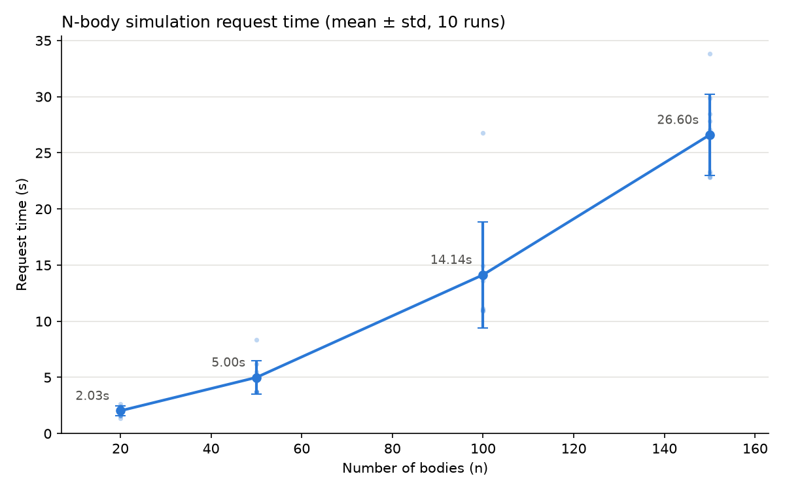
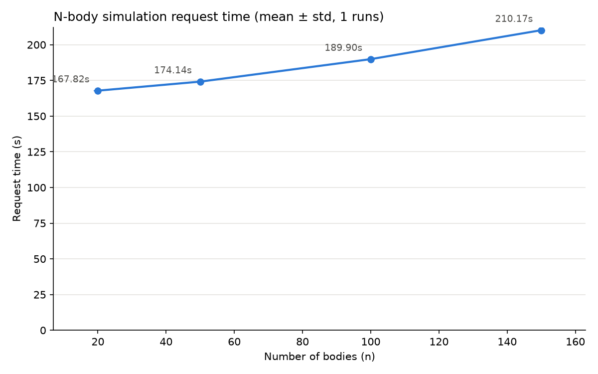

# Report Exercise 1

## Task 1

For the application i used a simple n-body simulation in python with fastAPI and a simple frontend. This code was generated by ChatGPT. I choose this because it is a simple and established benchmark. With an HTTP POST to /api/simulate and a payload with n and t_max it runs a simulation and returns the position of each body for each timestep.

### 1.

Explanation of the `main.tf` file:

```
terraform {
  required_version = ">= 1.5.0"

  required_providers {
    aws = {
      source  = "hashicorp/aws"
      version = "~> 5.0"
    }
  }
}
```

This sets up the terraform configuration. So what is the required version and that the required provider is aws.


```
provider "aws" {
  region = "us-east-1"
}
```
Sets aws as the provider with the specified Region


```
variable "ssh_allowed_cidr" {
  description = "CIDR block allowed to connect via SSH" 
  type        = string
  default     = "0.0.0.0/0" # open to the world
}
```
Input variable for which ip addresses can connect to server


```
variable "public_key_path" {
  description = "Path to your local SSH public key"
  type        = string
  default     = "~/.ssh/aws_ds.pub"
}
```

Input variable for path to ssh key


```
data "aws_ssm_parameter" "al2023_ami" {
  name = "/aws/service/ami-amazon-linux-latest/al2023-ami-kernel-default-x86_64"
}
```
Sets the AMI to the latest Amazon Linux 2023 (x86_64), AMI is disk image the instance boots from


```
data "aws_vpc" "default" {
  default = true
}
```

For the virtual private network (VPC), every account has a default VPC


```
resource "aws_key_pair" "ssh" {
  key_name   = "terraform-ec2-key"
  public_key = file(pathexpand(var.public_key_path))
}
```

For ssh identity file

```
resource "aws_security_group" "ec2_sg" {
  name        = "ec2-basic-sg"
  description = "Allow SSH and HTTP inbound, all outbound"
  vpc_id      = data.aws_vpc.default.id

  ingress {
    description = "SSH"
    from_port   = 22
    to_port     = 22
    protocol    = "tcp"
    cidr_blocks = [var.ssh_allowed_cidr]
  }

  ingress {
    description = "HTTP"
    from_port   = 80
    to_port     = 80
    protocol    = "tcp"
    cidr_blocks = ["0.0.0.0/0"]
  }

  egress {
    description = "Allow all outbound"
    from_port   = 0
    to_port     = 0
    protocol    = "-1"
    cidr_blocks = ["0.0.0.0/0"]
  }

  tags = {
    Name = "ec2-basic-sg"
  }
}
```

Security group, basically a stateful, virtual firewall

```
resource "aws_instance" "app" {
  ami = data.aws_ssm_parameter.al2023_ami.value
  instance_type = "t2.micro"
  vpc_security_group_ids = [aws_security_group.ec2_sg.id]
  key_name = aws_key_pair.ssh.key_name
  associate_public_ip_address = true

  tags = {
    Name = "al2023-terraform-instance"
  }
}
```

The EC2 Instance, so the actual server


```
output "instance_id" {
  description = "ID of the EC2 instance"
  value       = aws_instance.app.id
}

output "public_ip" {
  description = "Public IP address of the EC2 instance"
  value       = aws_instance.app.public_ip
}

output "ami_used" {
  description = "AMI ID that was resolved for Amazon Linux 2023"
  value       = data.aws_ssm_parameter.al2023_ami.value
  sensitive   = true
}
```

Important outputs to use


### 2.

In order to run the actual app, i needed to install a newer python version, since the default version was too old for the requirements. Additionally i needed to redirect the port 80 to 8000 which is the default port for uvicorn/fastAPI.
```
sudo dnf install -y iptables-nft 
sudo iptables -t nat -A PREROUTING -p tcp --dport 80 -j REDIRECT --to-port 8000
```

Alternatively I could have set the port of the app to 80 but this requires sudo privilidges and the ai overlords said it would be bad practise to do so. I could have also changed the security group in the terraform file, but this would have been more tedious.

All of this just shows that a docker container would be better instead of just running it.

### 3.

For the benchmark i measured the request time of a simulation request from my machine to the server with `/nbody-web/nbody_bench.sh`. I measured accross different n, which computationally scales quadratically and the payload increases linearly, while keeping the max_time fixed at 100.



It can be observed, that the stdev is relatively high, this is propably because of the latency of the data transfer. 

In general when inspecting the server with `lscpu`, we can see that it is not the most performant, with an Intel(R) Xeon(R) CPU E5-2686 v4 @ 2.30GHz and 1GB Ram.

## Task 2

### 1.

```
FROM python:3.12-slim

WORKDIR /app

COPY requirements.txt .
RUN pip install --no-cache-dir -r requirements.txt

COPY . .

EXPOSE 8000

CMD ["uvicorn", "app:app", "--host", "0.0.0.0", "--port", "8000"]

```

### 2.

In the nbody-web directory run:
`sudo docker build -t nbody .`
then  `docker run -p 80:8000 nbody`


### 3. 
In order to make two containers work for my setup, I needed to add 2 Ingress entries for 2 different ports and start the containers with the different ports respectively

so `docker run --name nbody1 -p 8000:8000 nbody` and `docker run --name nbody2 -p 8001:8000 nbody`.

## Task 3

### 1.
I choose to do the calc_acceleration as the lambda function. In `nbody-web-lambda/terraform` there are the terraform files to set up the lambda function. In the pyhton code i made use of boto3.

### 2.
Nothing really to be done except I added `iam_instance_profile = "LabInstanceProfile"` to `aws_instance` in the main.tf from task 1 so that it has access to the lambda function.

### 3.


We can see that the request time is much higher. This is because for every time step it needs to call this function and transfer the data. This is the biggest bottleneck here.
