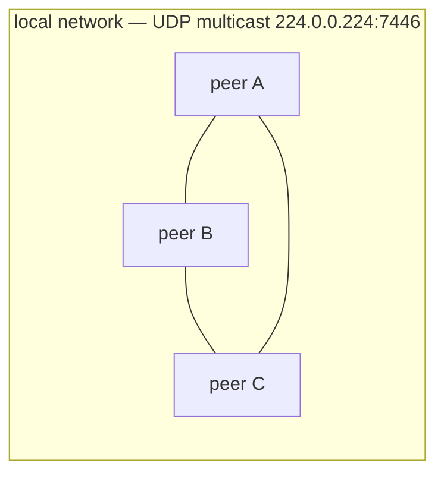
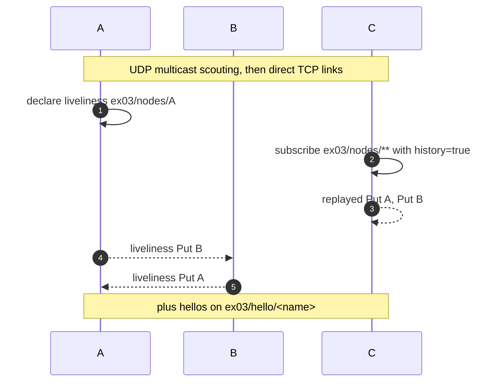
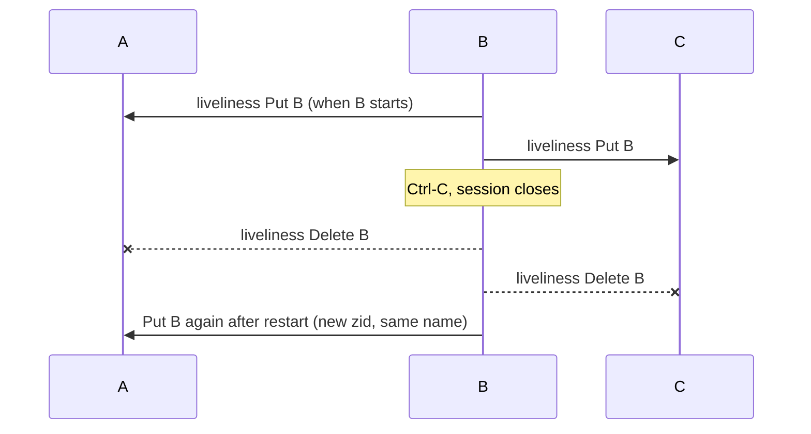
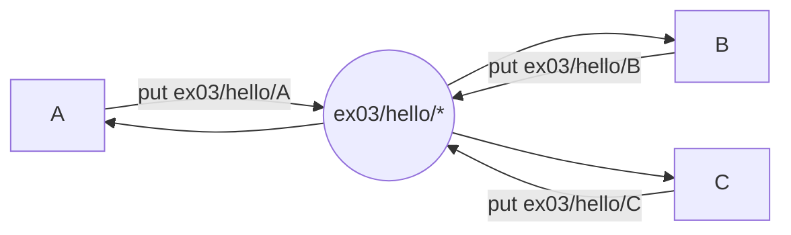
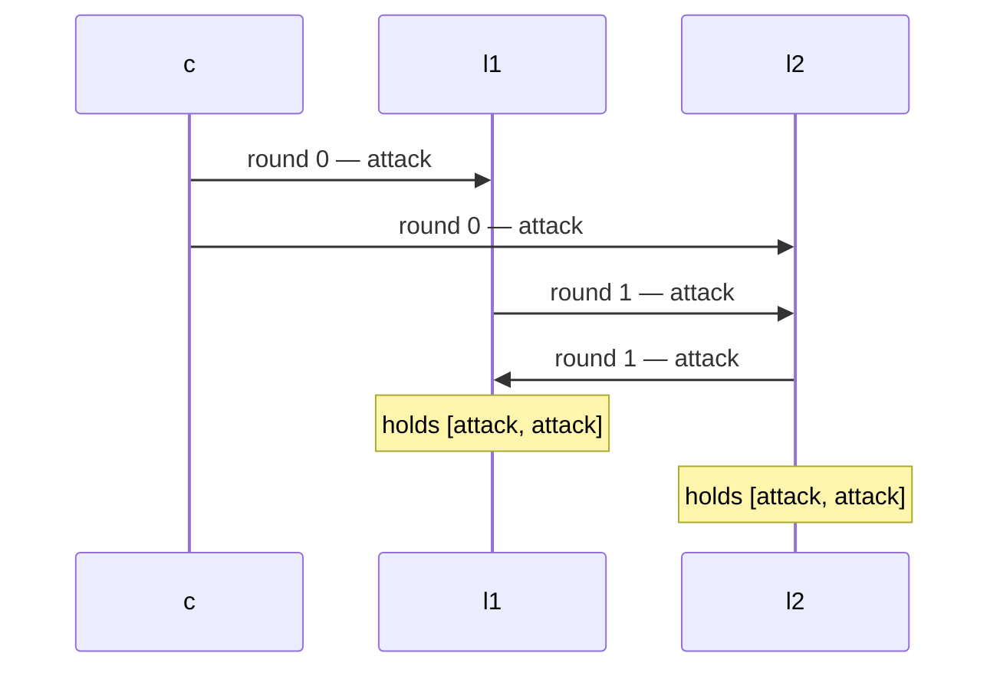
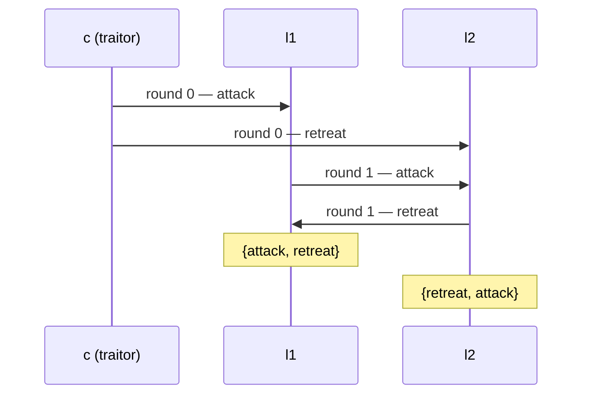
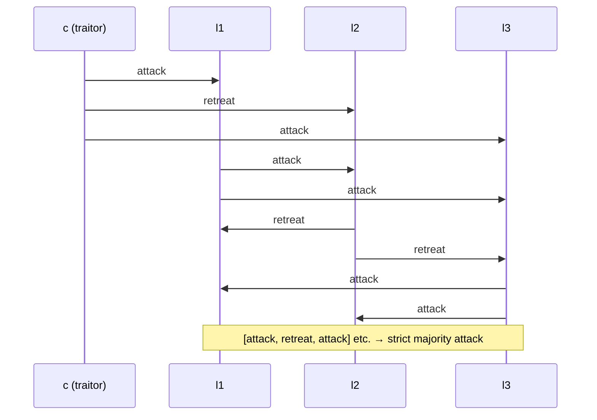
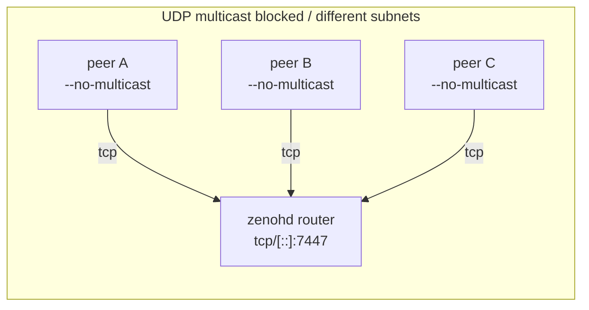

# EX03 Report: Network Topologies

**Student Name:** David Mairhofer
**Student ID:** `csbc2382`

CLARIFICATION: the c++ version and report is described by [cpp/README.md](cpp/README.md)! I just quickly threw together this Rust version using DeepSeek for the Zenoh plumbing (session setup, CLI, message framing);
the protocol logic and all experiments are mine.

## Setup

Two small Rust binaries on the [Zenoh](https://zenoh.io) crate (native Rust implementation):
`src/bin/peer.rs` for Tasks 1+2, `src/bin/byzantine.rs` for Task 3, `src/lib.rs` for shared session
plumbing.

```bash
cd ex03/dm && cargo build --release
```

### Zenoh in a nutshell

- **Session** — a process joins the network as a peer (default: direct mesh, no broker), client or
  router. Each session has a random `zid`.
- **Scouting** — peers find each other over UDP multicast (`224.0.0.224:7446` by default), then open
  TCP links. Verified via `RUST_LOG=zenoh=info`: `Listening scout messages on 224.0.0.224:7446`.
- **Key expression** — hierarchical name, `*` = one level, `**` = any depth. It is the only
  "address" pub/sub needs.
- **Pub/sub** — `put` on a key expression; matching subscribers get the `Sample` directly over the
  mesh.
- **Liveliness** — a node declares a token while alive; subscribers get `Put` when it appears and
  `Delete` when it disappears. `history(true)` replays tokens that already existed.

| key expression      | kind       | meaning                   |
| ------------------- | ---------- | ------------------------- |
| `ex03/nodes/<name>` | liveliness | "node `<name>` is alive"  |
| `ex03/nodes/**`     | liveliness | discovery stream          |
| `ex03/hello/<name>` | pub/sub    | hello messages per node   |
| `ex03/byz/<name>`   | pub/sub    | Byzantine inbox of a node |



## Task 1 — Dynamic discovery

### 1.1 Three nodes

```bash
# one terminal each
./target/release/peer --name A
./target/release/peer --name B
./target/release/peer --name C
```

A's terminal (B and C started ~1 s later):

```
[A] session opened (zid a4d9c42b1248082d2f806d441074140)
[A] announced as ex03/nodes/A
[A] known peers: []
[A] peer joined: B
[A] peer joined: C
[A] known peers: [B, C]
```



### 1.2 Leaving and rejoining

`Ctrl-C` in B, wait ~3 s, start it again:

```
[A] peer left: B
[A] known peers: [C]
[A] peer joined: B
[A] known peers: [B, C]
```

Measured on this machine, from killing B to A printing `peer left`: **5 ms**. From starting B again
to A printing `peer joined`: **32 ms**. B's `zid` changes on every start, the name does not. The
`known peers` line lags by up to `--peers-ms` because it is only a periodic snapshot.

> **How does a node learn another is available?**
> Each node declares a liveliness token (a key expression) for its session. Tokens spread over the
> scouted peer links; a subscriber on `ex03/nodes/**` gets `Put` when a token appears (plus a replay
> of existing ones with `history(true)`) and `Delete` when its session ends.

> **What happens when a node leaves or joins?**
> Its token is removed when the session closes (`Delete`, 5 ms here) and re-declared on restart
> (`Put`, 32 ms). Pub/sub deliveries simply stop and restart; nothing is buffered for the absent
> node.

> **Can you trust the discovered identity and the messages?**
> No. A token is just a key expression that any session may declare: a second process can claim
> `ex03/nodes/B`, and anyone can publish into `ex03/byz/l1`. Names and payloads are self-declared
> and unauthenticated, which is fine for discovery but is exactly the Byzantine problem in Task 3.



## Task 2 — Publish/subscribe

```bash
./target/release/peer --name A --hello-ms 1000   # one terminal each
./target/release/peer --name B --hello-ms 1000
./target/release/peer --name C --hello-ms 1000
```

```
[A] hello tx: Hello from Node A
[A] hello rx from B: Hello from Node B
[A] hello rx from C: Hello from Node C
```

Each node publishes to its own key `ex03/hello/<name>`, everyone subscribes to `ex03/hello/*`.
Nothing is configured with addresses.



> **Static vs. dynamic discovery.**
> Static: endpoints known from config, discovery is manual bookkeeping, fine for fixed small
> deployments. Dynamic: the middleware scouting finds sessions and matches key expressions, so
> nodes can start anywhere and at any time; the app only knows names.

> **Why is publish/subscribe useful here?**
> Publishers and subscribers are decoupled in space (no addresses/point-to-point connections) and
> in time (fit for many subscribers, late joiners), and matching is done by key expression, so
> adding a node requires no change in any other node.

> **Is discovery alone sufficient for fault tolerance?**
> No. Liveliness tells you a session exists, not that its application is correct or caught up:
> pub/sub has no replay/ack by default (hellos sent before a subscriber joined are lost, observed
> when starting B late), and no delivery guarantee if links break. Fault tolerance needs
> acknowledgements/retries or consensus on top.

## Task 3 — Byzantine generals

### Design

One round of oral messages as JSON over Zenoh, inbox key `ex03/byz/<to>`:

```json
{"from": "c", "round": 0, "order": "attack"}
```

Commander waits until all lieutenants are alive, sends `round: 0` to each. Each lieutenant forwards
its received order to every other lieutenant (`round: 1`), collects the forwards for up to 2 s,
then decides from the values it holds: the commander's order plus one forward per other lieutenant.
`--lie l1=attack,l2=retreat` makes a traitor commander send different orders,
`--traitor --forward-lie retreat` makes a traitor lieutenant lie; `--chaos` randomises.

Because Zenoh does not authenticate publishers, the `from` field is self-declared — the Byzantine
assumption made real: any node can say anything to anyone.



### 3.1 All loyal (3 nodes)

```bash
./target/release/byzantine --name c  --role commander  --lieutenants l1,l2 --order attack
./target/release/byzantine --name l1 --role lieutenant --commander c --lieutenants l1,l2
./target/release/byzantine --name l2 --role lieutenant --commander c --lieutenants l1,l2
```

```
[l1] holds [attack, attack] (commander + 1 forwards)   → [l1] DECISION attack
[l2] holds [attack, attack] (commander + 1 forwards)   → [l2] DECISION attack
```

### 3.2 Traitor commander (split order)

Add `--traitor --lie l1=attack,l2=retreat` to the commander's command:

```
[c] -> l1: attack (round 0)
[c] -> l2: retreat (round 0)
[l1] holds [attack, retreat]  → [l1] DECISION retreat
[l2] holds [retreat, attack]  → [l2] DECISION retreat
```

Both hold the same multiset, so they agree — but not necessarily on either of the commander's two
orders. My tie rule is "1–1 → retreat" (the safe order).



> **Are the decisions the same?**
> Yes (retreat/retreat), because both lieutenants hold the same two values; only the order differs.

> **Why are "commander is the traitor" and "the other lieutenant is the traitor" indistinguishable?**
> l1 receives `attack` (supposedly from c) and `retreat` (supposedly from l2). Either c sent
> `attack`/`retreat` to the two lieutenants (c is lying), or c sent `attack` to both and l2 lied when
> forwarding. Both explanations produce exactly the same local view, so l1 cannot decide which node
> to blame.

The other horn, tested as well — commander **loyal** (`attack`), l2 lying (`--forward-lie retreat`):

```
[l1] holds [attack, retreat]  → [l1] DECISION retreat   ← validity violated
[l2] holds [attack, attack]   → [l2] DECISION attack
```

With `retreat` as commander order the same setup gives l1 `[retreat, attack] → retreat` (valid by
luck). No tie rule fixes both: tie→retreat breaks validity for `attack`, tie→attack breaks it for
`retreat`. **Three nodes cannot handle one traitor** — that is the impossibility.

### 3.3 Four nodes (majority)

Commander + 3 lieutenants, each lieutenant holds 3 values, so a strict majority always exists.

| run | faulty node | values l1 | dec l1 | values l2 | dec l2 | values l3 | dec l3 |
| --- | --- | --- | --- | --- | --- | --- | --- |
| all loyal | – | a,a,a | attack | a,a,a | attack | a,a,a | attack |
| traitor c (`a,r,a`) | c | a,r,a | attack | r,a,a | attack | a,a,r | attack |
| traitor l2 (lies `r`) | l2 | a,r,a | attack | a,a,a | attack | a,r,a | attack |

All loyal lieutenants agree every time: with three values, one faulty node can corrupt at most one
of them, so the two honest values still form a majority.



### 3.4 Discussion

> **Why majority with three lieutenants but not with two?**
> Agreement needs `n >= 3f+1` for oral messages. With 3 lieutenants (`n=4, f=1`) a loyal node has 3
> values, at most 1 corrupted → majority = honest value. With 2 lieutenants (`n=3, f=1`) it has
> only 2 values, so one liar creates a 1–1 tie and the loyal node cannot tell which value is the
> lie. Three nodes are one short of the 4 needed.

> **What does the designated commander provide over a fully decentralized protocol?**
> A single proposer/order anchor: all nodes start from one value and only need to agree on it.
> Without a commander (or additional rounds) nodes propose values themselves and need real
> consensus (Paxos/PBFT-style), i.e. more communication rounds. The commander is not trusted more —
> just a structural simplification.

> **Can loyal nodes identify the traitor?**
> Not with one round of oral (unsigned) messages; the view is ambiguous as shown in 3.2. With
> digital signatures, a node that says different things to different peers can be exposed by
> exchanging signed messages (signed-message agreement tolerates a traitor already at 3 nodes).
> Zenoh authentication is not enabled here, so signatures would have to be added at the application
> layer.

> **Multicast scouting is blocked — how do nodes communicate?**
> Router mode with explicit endpoints. Peers disable UDP scouting and connect to a router, which
> relays over TCP, including across subnets. Verified with the prebuilt `zenohd` 1.10.2:

```bash
mkdir -p .tools && cd .tools && curl -sSL -o zenohd.zip \
  https://github.com/eclipse-zenoh/zenoh/releases/download/1.10.2/zenoh-1.10.2-x86_64-unknown-linux-gnu-standalone.zip
unzip -o zenohd.zip && ./zenohd        # terminal 0, listens on tcp/[::]:7447

# terminals 1-3
./target/release/peer --name A --no-multicast --connect tcp/127.0.0.1:7447
./target/release/peer --name B --no-multicast --connect tcp/127.0.0.1:7447
./target/release/peer --name C --no-multicast --connect tcp/127.0.0.1:7447
```

Output: `[A] peer joined: B`, `[A] hello rx from B: Hello from Node B` — same behaviour, routed.



Other options: static peer endpoints, gossip scouting, or client mode to a router.

### Experiment decisions

| # | nodes | faulty node | order | l1 | l2 | l3 | loyal agree | valid |
| - | --- | --- | --- | --- | --- | --- | --- | --- |
| 1 | 3 | none | attack | attack | attack | – | yes | yes |
| 2 | 3 | commander split | attack | retreat | retreat | – | yes | n/a |
| 3 | 3 | l2 lies | attack | retreat | attack | – | l1 only | **no** |
| 4 | 3 | l2 lies | retreat | retreat | retreat | – | yes | yes |
| 5 | 4 | none | attack | attack | attack | attack | yes | yes |
| 6 | 4 | commander split | attack | attack | attack | attack | yes | n/a |
| 7 | 4 | l2 lies | attack | attack | attack | attack | yes | yes |

## Observations and surprises

- Leaving is detected almost instantly (**5 ms**): the TCP link drops with the session, so the
  `Delete` is immediate; a node that is merely *partitioned* would have to wait for the transport
  lease instead (tens of seconds).
- Joining takes longer (**32 ms** here) because scouting + link establishment + token propagation
  happen first; with a late start this is why hellos can arrive before the `peer joined` line.
- `history(true)` is what makes late joiners work for liveliness; pub/sub has no history, so B
  joining late only sees hellos published after it subscribed (observed).
- The token is per *session*, not per name — nothing prevents two processes calling themselves `B`;
  then the token key collides and a `Delete` is printed when one of them dies even though the name
  is still alive. Names are not identifiers for trust.
- `--no-multicast --connect` to a non-running router does not error out: the session opens, prints
  `WARN ... Scouting delay elapsed before start conditions are met.`, and the node just never sees
  a peer — silent isolation, worth knowing when debugging.
- The `zid` changes on every restart; the key-expression name does not. For "is this the same
  node?" the name is the logical identity, the zid the process identity.
- Byzantine runs are cheap (decisions within milliseconds over localhost), but the commander needs
  a short `--settle-ms` for its last `put` to flush.

## Source layout

```
ex03/dm/
  Cargo.toml
  README.md
  src/lib.rs                   # session config, liveliness keys, wait_for_nodes
  src/bin/peer.rs              # tasks 1 + 2
  src/bin/byzantine.rs         # task 3
```

`cargo build --release`; only external piece is the optional `zenohd` for 3.4.
