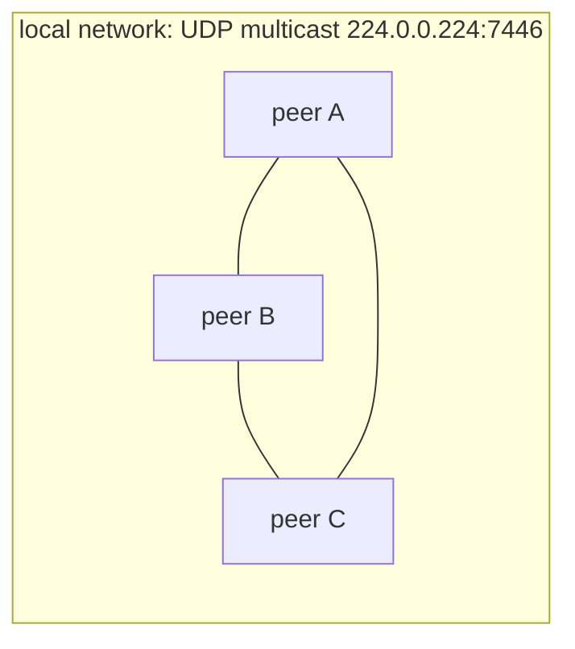
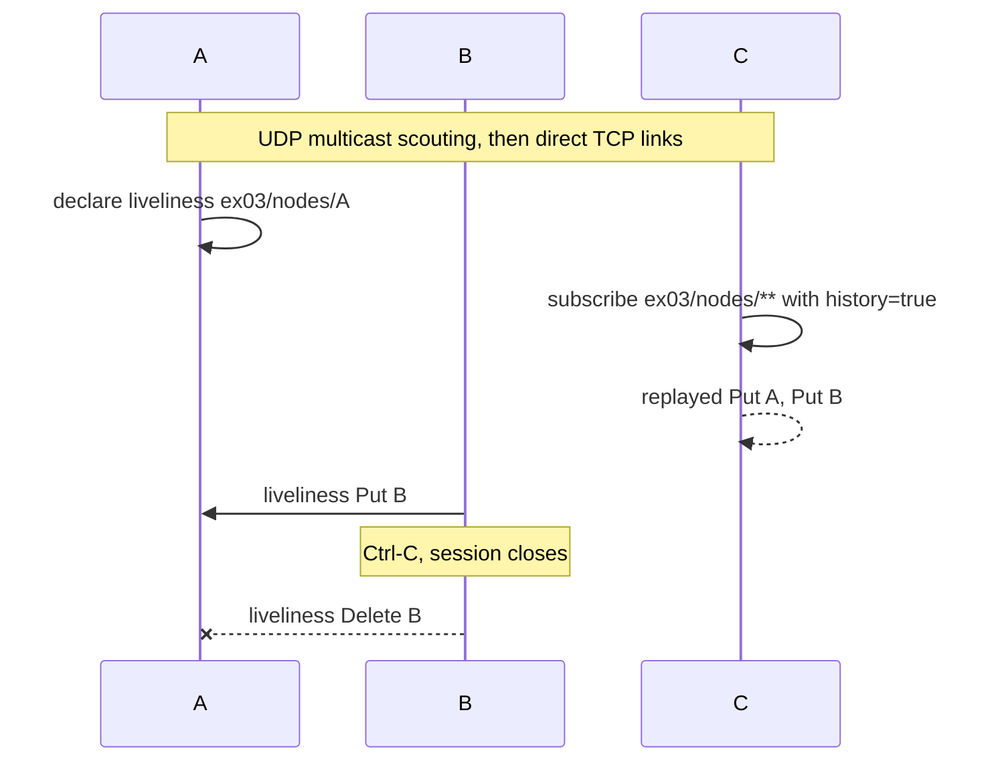
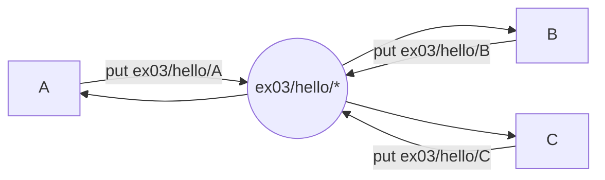
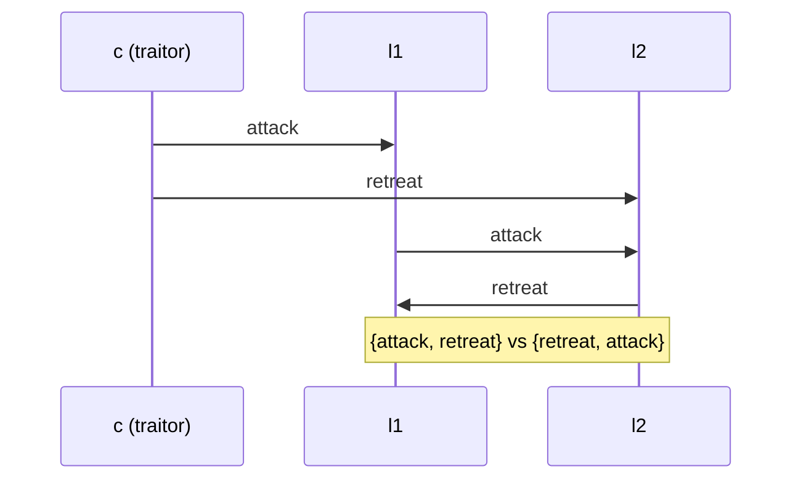
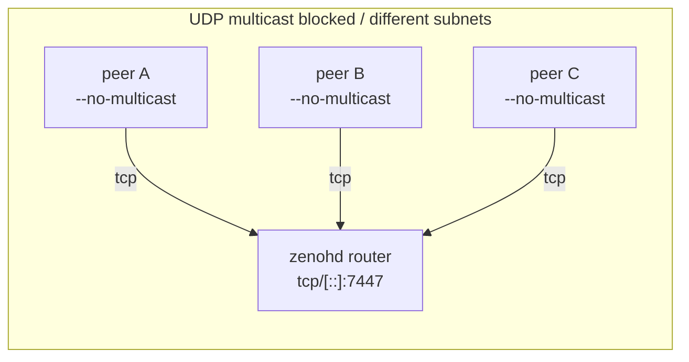

# EX03 Report: Network Topologies

**Student Name:** David Mairhofer
**Student ID:** `csbc2382`

CLARIFICATION: I used DeepSeek for the Rust/C++ plumbing (session setup, argument parsing);
the protocol logic, experiments and interpretation are mine.

This report describes the minimal C++ implementation (`./peer`, `./byzantine`) built on
[zenoh-cpp](https://github.com/eclipse-zenoh/zenoh-cpp) 1.10.2

To set up and build:

```bash
./bootstrap.sh      # fetch .vendor/ (zenoh-c runtime + zenoh-cpp headers); you need internet access
make                # g++ -std=c++17, builds ./peer and ./byzantine
```

## Zenoh crash course

(put together with the hlep of deepseek)

- **Session:** a process joins as a peer (default: direct mesh, no broker). Every session gets a
  random `zid`.
- **Scouting:** peers find each other over UDP multicast (`224.0.0.224:7446`), then open TCP links.
- **Key expression:** hierarchical name, `*` = one level, `**` = any depth. It is the only
  "address" pub/sub needs.
- **Pub/sub:** `put` on a key expression, matching subscribers receive the sample directly.
- **Liveliness:** a node declares a token while alive; subscribers get PUT when it appears and
  DELETE when the session ends. `history=true` replays tokens declared before subscribing.

| key expression      | kind       | meaning                  |
| ------------------- | ---------- | ------------------------ |
| `ex03/nodes/<name>` | liveliness | "node `<name>` is alive" |
| `ex03/nodes/**`     | liveliness | discovery stream         |
| `ex03/hello/<name>` | pub/sub    | hello messages per node  |
| `ex03/byz/<name>`   | pub/sub    | Byzantine inbox of a node |



## Task 1: Dynamic discovery

Three terminals:

```bash
./peer --name A
./peer --name B
./peer --name C
```

A's output (B and C started ~1 s later):

```
[A] announced as ex03/nodes/A
[A] known peers: []
[A] peer joined: B
[A] peer joined: C
[A] known peers: [B, C]
[A] hello rx from B: Hello from Node B
```

Stopping B (`Ctrl-C`, a few seconds) and restarting it shows the full lifecycle in A:

```
[A] peer left: B
[A] known peers: [C]
[A] peer joined: B
[A] known peers: [B, C]
```

Measured here: B killed → A printed `peer left` within milliseconds once the TCP link dropped; a
restart is visible as soon as B's token is re-declared (tens of ms). The periodic `known peers` line
print interval can be set with `--peers-ms`



> **How does a node learn that another node is available?**
> Each node declares a liveliness token (a key expression) for its session. Tokens are propagated
> over the scouted peer links; a subscriber on `ex03/nodes/**` receives PUT when a token appears,
> plus a replay of already-existing tokens because of `history=true`.

> **What happens when a node leaves or joins?**
> Its token disappears when the session closes (DELETE) and is re-declared on restart (PUT).
> Pub/sub deliveries simply stop and restart; nothing is buffered for the absent node, which is why
> B joining late misses earlier hellos.

> **Can you trust the discovered identity and the messages?**
> No. A token is just a key expression any session may declare: another process can claim
> `ex03/nodes/B`, and anyone can publish into `ex03/byz/l1`. Names and payloads are self-declared
> and unauthenticated; fine for discovery, but exactly the Byzantine problem in Task 3.

## Task 2: Publish/subscribe

```bash
./peer --name A --hello-ms 1000     # and B, C
```

```
[A] hello tx: Hello from Node A
[A] hello rx from B: Hello from Node B
[A] hello rx from C: Hello from Node C
```

Each node publishes on its own key `ex03/hello/<name>`; everyone subscribes to `ex03/hello/*`. No
addresses are configured anywhere.



> **Static vs. dynamic discovery.**
> Static: endpoints are known from config and discovery is manual bookkeeping; fine for fixed
> small deployments. Dynamic: the middleware scouting finds sessions and matches key expressions,
> so nodes can start anywhere and at any time; the application only knows names.

> **Why is publish/subscribe useful in a distributed system?**
> Publishers and subscribers are decoupled in space (no addresses or point-to-point connections) and
> in time (many subscribers, late joiners), matching happens by key expression, and adding a node
> requires no change in any other node.

> **Is discovery alone sufficient for fault tolerance?**
> No. Liveliness tells you a session exists, not that its application is correct or caught up:
> there is no replay/ack by default (hellos sent before a subscriber joined are lost), and no
> delivery guarantee if links break. Fault tolerance needs acknowledgements/retries or consensus on
> top of discovery.

## Task 3: Byzantine generals

One round of oral messages as plain text `round|from|order` over `ex03/byz/<to>`, e.g. `0|c|attack`.
The commander sends `round 0` to every lieutenant; each lieutenant forwards what it received as
`round 1` to the other lieutenants, collects the forwards, prepends the commander's value and decides
by strict majority (1–1 tie → `retreat`, the safe order).

```bash
# 3 nodes, all loyal
./byzantine --name c  --role commander  --lieutenants l1,l2 --order attack
./byzantine --name l1 --role lieutenant --commander c --lieutenants l1,l2
./byzantine --name l2 --role lieutenant --commander c --lieutenants l1,l2
```

```
[l1] commander order: attack
[l1] holds [attack, attack] (commander + 1 forwards) -> DECISION attack
[l2] holds [attack, attack] (commander + 1 forwards) -> DECISION attack
```

Traitor commander, split order (`--traitor --lie 'l1=attack,l2=retreat'` on the commander):

```
[c] -> l1: attack (round 0)
[c] -> l2: retreat (round 0)
[l1] holds [attack, retreat] (commander + 1 forwards) -> DECISION retreat
[l2] holds [retreat, attack] (commander + 1 forwards) -> DECISION retreat
```

Four nodes (`--lieutenants l1,l2,l3`), all loyal → every lieutenant holds `[attack, attack, attack]`
and decides `attack`. Traitor lieutenant (l2 uses `--traitor --forward-lie retreat`):

| nodes | faulty   | l1 holds                 | l1 | l2 holds                 | l2 | l3 holds                 | l3 |
| ----- | -------- | ------------------------ | -- | ------------------------ | -- | ------------------------ | -- |
| 4     | l2 lies  | `[attack,retreat,attack]` | attack | `[attack,attack,attack]` | attack | `[attack,attack,retreat]` | attack |

Loyal lieutenants agree, and their decision equals the commander's loyal order: with 3 values at
most 1 is corrupted, so the 2 honest ones always form a majority.



### Discussion questions

> **Why does majority voting succeed with three lieutenants but fail with only two?**
> With 3 lieutenants (`n=4, f=1`) a loyal node holds 3 values and at most 1 is a lie, so the honest
> majority (2 of 3) always wins. With 2 lieutenants (`n=3, f=1`) a loyal node holds only 2 values;
> one liar reduces its view to a 1–1 tie, and the loyal node cannot tell which value is the lie.
> Oral-message agreement needs `n >= 3f+1`, i.e. at least 4 nodes for one traitor: three nodes are
> one short.

> **What does the designated commander provide compared to a fully decentralized protocol?**
> A single proposer/order anchor: every node starts from one value and only has to agree on it.
> Without a commander (or with extra rounds), nodes propose values themselves and need real
> consensus (Paxos/PBFT-style), which costs more communication rounds. The commander is not trusted
> more than anyone else; it just fixes the value to agree on.

> **What happens if the commander is the traitor? Are the two traitor cases distinguishable?**
> The commander may send different orders to different lieutenants (the split run above). Each
> lieutenant sees one received order plus one forward, and the two explanations: "commander lied" vs
> "the other lieutenant lied when forwarding" produce exactly the same local view. So l1 cannot
> identify the traitor from one round of oral messages; both cases only guarantee that loyal
> lieutenants *agree* (possibly on the safe order, not necessarily on the commander's).

> **Can you identify the traitor?**
> Not with one round of unsigned oral messages, as above. With digital signatures, a node that says
> different things to different peers can be exposed by exchanging signed messages (signed-message
> agreement already tolerates a traitor at 3 nodes). Zenoh authentication is not enabled here, so
> signatures would have to be added at the application layer.

> **Multicast scouting is blocked - how can nodes communicate?**
> Router mode with explicit endpoints: UDP scouting disabled, peers connect to a `zenohd` router that
> relays over TCP (also across subnets):

```bash
mkdir -p .tools && cd .tools && curl -sSL -o zenohd.zip \
  https://github.com/eclipse-zenoh/zenoh/releases/download/1.10.2/zenoh-1.10.2-x86_64-unknown-linux-gnu-standalone.zip
unzip -o zenohd.zip && ./zenohd          # terminal 0, listens on tcp/[::]:7447

./peer --name A --no-multicast --connect tcp/127.0.0.1:7447   # and B, C
```

Same `peer joined` / `hello rx` output, but the links go through the router. Alternatives: static
peer endpoints, gossip scouting, or client mode to a router.



## Design notes / observations

- Text wire format instead of JSON: the message is `round|from|order` and `std::stoi` is enough;
  no library, and the message is visible in `tcpdump`-like debugging without a parser.
- The commander waits ~1.5 s after declaring its token before sending, so all lieutenants have
  subscribed. Without it, early PUTs are lost (no history on pub/sub) and a lieutenant times out.
- `from` is self-declared: any process can send to `ex03/byz/<name>`. That is the exercise's
  assumption, not an accident of the implementation.
- Discovery is per session, not per name: two processes claiming `B` collide on the same token;
  names are logical identity, `zid` is process identity.
- `--no-multicast` with a missing router only warns ("Scouting delay elapsed before start
  conditions are met") and then never sees a peer: silent isolation, worth remembering when debugging.
- The full source of the report is generated from this README:
  `./make-pdf.sh` (mermaid → PNG via kroki.io, then pandoc + xelatex).
