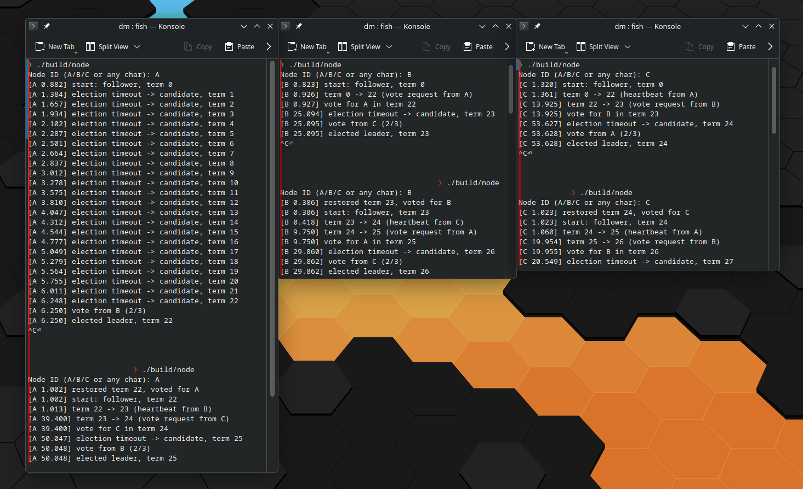
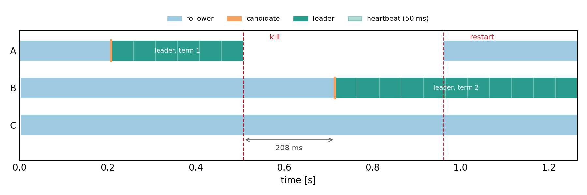
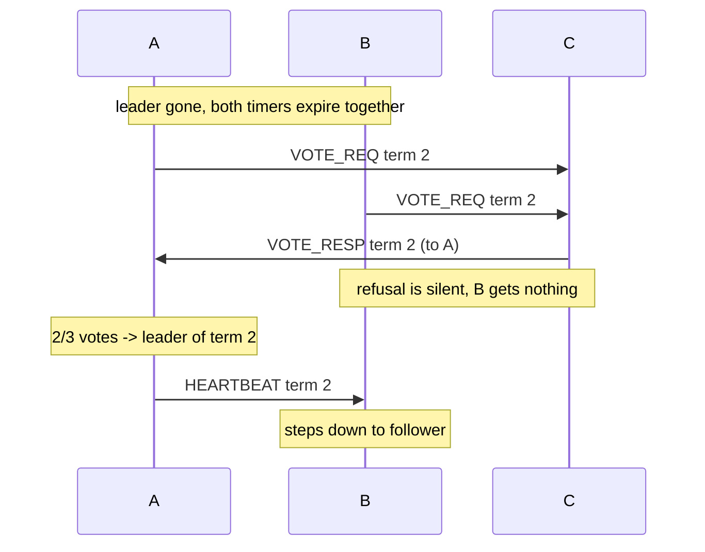

# EX04 – Leader Election

**Student Name:** David Mairhofer
**Student ID:**  `csbc2382`

---

## to build and run

```bash
cmake -B build -S .
cmake --build build

./build/node
Node ID (A/B/C): A
```

Full experiment (election, leader crash, restart) and its plot:

> (CLARIFICATION: these 2 scripts were written by deepseek to have a nice visualization)

```bash
./run_experiment.sh  # logs in samples/
python3 plot.py      # timeline.png (needs python3-matplotlib)
```

Manual testing:



## Implementation

Look at `src/node.cpp`. I used zenoh like in the last week. topic `ex04/election` for all messages. 

All nodes just send the raw bytes of the `Message` struct. All nodes run the same binary, so I've just ignored struct padding and byte order.

```cpp
struct Message {
	char type; // 'R' request for votes, 'V' vote, 'H' heartbeat
	char from; // sender
	char to;   // 'V' only: the candidate being voted for
	int term;  // native byte order
};
```

```cpp
// cluster size could be determined dynamically with the zenoh liveliness stuff, but I didn't have time to get to that yet
constexpr int kClusterSize = 3;  // majority is 2
constexpr auto kHeartbeatInterval = 50ms;
constexpr auto kElectionTimeoutMin = 150ms;
constexpr auto kElectionTimeoutMax = 300ms;

struct Node {
	char id;

	// persistent
	int term = 0;
	char votedFor = 0; // 0 = did not vote

	// volatile
	Role role = Role::Follower;
	char leader = 0; // 0 = unknown
	std::set<char> votes;

	Clock::time_point lastContact;
	Clock::time_point nextHeartbeat; // leader only
	std::chrono::milliseconds electionTimeout{};
};
```

```cpp
// main logic loop
...
std::deque<Message> batch{};
{
    std::lock_guard<std::mutex> lock(inboxMutex);
    batch.swap(inbox);
}
for (auto &m : batch) {
    // zenoh also delivers the node's own puts:
    if (m.from == n.id)
        continue;
    // stale message from an old term
    // e.g. an old leader that has not yet realized it is no longer the leader
    if (m.term < n.term)
        continue;
    if (m.type == 'H')
        handle_heartbeat(n, m);
    else if (m.type == 'R')
        handle_vote_req(n, m, session);
    else if (m.type == 'V')
        handle_vote_resp(n, m);
}

auto now = Clock::now();
if (n.role == Role::Leader) {
    if (now >= n.nextHeartbeat) {
        send(session, Message{'H', n.id, 0, n.term});
        n.nextHeartbeat = now + kHeartbeatInterval;
        if (kHeartbeatInterval >= 500ms) {
            log(n, "heartbeat-log: still leader; term " + std::to_string(n.term));
        }
    }
// follower/candidate timeout
} else if (now - n.lastContact >= n.electionTimeout) {
    start_election(n, session);  // term++, vote self, broadcast 'R'
}
```

A candidate becomes leader once it holds a majority (`votes * 2 > kClusterSize`), then sends heartbeats every `kHeartbeatInterval`.

## Experiments

| # | Event | Time | Term | Result |
|:--|:------------|:------|:----|:--------------------------------------------------------|
| 2.1 | A, B, C started | 0.000 s | 1 | A elected after 208 ms; C votes for it; its heartbeats keep the followers' timers from expiring |
| 2.2 | leader A killed | 0.507 s | 1 | B times out 207 ms later -> candidate & broadcasts vote request |
| 2.2 | C receives vote request from B | 0.714 s | 2 |  C votes for B
| 2.2 | B elected | 0.715 s | 2 | 208 ms after the crash; A is still down, B sends heartbeats; C follows B after receiving first heartbeat |
| 2.3 | A restarted | 0.961 s | 1 (stale) | restores persistent state (term: 1, votedFor: A; I don't think role should be persistent, but it should still work even if it was persistent) |
| 2.3 | A receives heartbeat from B | 0.967 s | 2 | first heartbeat from B updates it to term 2 in 6 ms and becomes follower |

logs:

```
[A 0.206] election timeout -> candidate, term 1
[A 0.207] vote from C (2/3)
[A 0.207] elected leader, term 1
[B 0.712] election timeout -> candidate, term 2
[B 0.713] vote from C (2/3)
[B 0.713] elected leader, term 2
[A 0.000] restored term 1, voted for A
[A 0.006] term 1 -> 2 (heartbeat from B)
```



Something that could happen if multiple nodes time out at the same time / during the vote request transfer latency is that there exist multiple candidates; that would be solved like this:



- A node grants at most one candidate per term (hence why we save `votedFor`), so C's single only goes to the first requester

It could also be a tie (e.g. if C was the previous leader and is now down, so A and B both have 1 vote): in that case the candidates simply wait for their next election timeout and start a new term. The random timeout should guarantee that at some point one of the candidates wins (as long as the timeout range is larger than the network latency)

## Answers

> Why are randomized election timeouts critical for preventing perpetual split votes?

Because as long as the timeout range is larger than the network latency, you it will eventually happen that one node's timeout expires and it's vote request is received before the other node's timeout to break the tie

> What happens if two candidates receive an equal number of votes in a cluster, and how does the system recover?

a candidate with no majority simply waits for at most as long as its (re-randomized) election timeout and then starts a new term (incrementing its term, voting for itself, and broadcasting a new vote request). So ties just delay the election by another `timeout` amount of time. Look at experiments for further details.

> How does comparing currentTerm prevent an isolated or delayed node from disrupting the active cluster with stale messages?

every message with `term < currentTerm` is dropped, and any message with a larger term updates the local term and demotes the receiver to follower. An isolated node stuck in an old term can neither collect votes (its requests are rejected) break the system be sending heartbeats (with the old term as tag). on reconnection the current leader's heartbeat outranks its term counter (task 2.3: 7 ms) and it adjusts its term and role accordingly

> Is leader election alone sufficient to guarantee linearizable consistency in a distributed database? Explain briefly

no. you still need to consolidate and resolve transaction conflicts, logs, etc. Even if all operations are atomic and only the leader keeps all the data & does all the operations, there is still the problem of "get, update, set" operation race conditions (like talked about in a previous week)

## Notes

- voting also resets the voter's "interaction/heartbeat timeout timer", so node that already voted doesn't quickly start a second, competing election
- in 10 kill/restart runs, 1 split the next term's vote 1-1 and needed one extra timeout (~200 ms)
- Heartbeat lines are only logged with the slow debug constants (`kHeartbeatInterval >= 500 ms`); at 50 ms that would be 20 lines per second
- Persisted term makes the restart observable: A came back with term 1 and was corrected by the first heartbeat (delete the `.election_state_<id>` file to start anew from term 0)
- role is not persisted, as it is just safer in my opinion to always start as a follower (at worst you waste a `timeout` amount of time and a re-election)