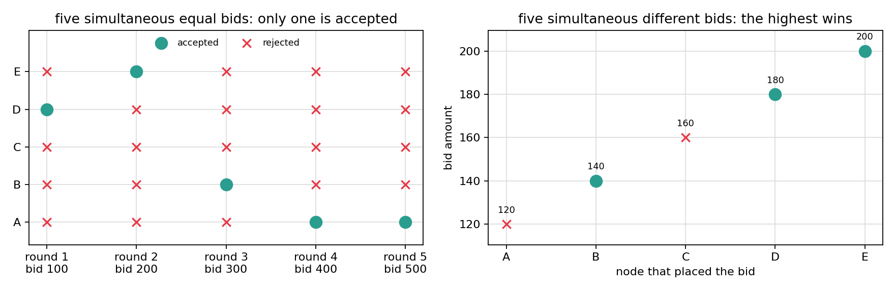

# EX05 – Fault Tolerance: A Distributed Auction

**Student Name:** David Mairhofer
**Student ID:** `csbc2382`

---

## to build and run

The exercise asks for 5 nodes on 5 separate machines plus a ZooKeeper (standalone is enough). `terraform` creates those 6 VMs. For the terraform scripts I took the one from week 1 and modified/extended it.

`deploy.sh` installs ZooKeeper on the 6th one, builds the C client and the node on the first app VM and copies the binary to the other four. `run_experiment.sh` then drives all nodes over ssh and `plot.py` draws the figure from the collected logs.
Initially I did this manually once, and after getting it to work once I used an LLM to generate the 3 scripts.

> (CLARIFICATION: `deploy.sh`, `run_experiment.sh` and `plot.py` were written by deepseek so that the experiments are easily reproducible)

```bash
cd ex05/dm
terraform init && terraform apply   # 5 app VMs + 1 ZooKeeper VM (IPs in terraform output)
./deploy.sh                         # ~10 min, mostly the C client build
./run_experiment.sh                 # logs in results/, summary at the end
python3 plot.py                     # races.png
terraform destroy                   # important to not incur a bunch of AWS costs
```

Manually on one machine (needs the ZooKeeper C client, `libzookeeper_mt`):

```bash
cmake -B build -S . -DZOOKEEPER_ROOT=$HOME/zk-c
cmake --build build
./build/node
Node ID (A/B/C/...): A
Auction ID (default 1): 1
ZooKeeper host:port (default 127.0.0.1:2181): 172.31.94.118:2181
commands: bid <amount> | query | close | quit
```

## Implementation

One znode per auction, `/ex05/auctions/<auctionId>`, holding the complete state as a small string, e.g. `open|120|A` or `closed|120|A`. The `version` in the Auction struct is the version that ZooKeeper has for it's znode (for the compare and set operation)

```cpp
struct Auction {
	bool closed = false;
	long highestBid = 0;
	std::string highestBidder = "";
	int version = -1;  // znode data version, used as the CAS version
};
```

Every bid reads the current state, checks it, and writes back only if the version did not change in between:

```cpp
Auction auction;
int result = get_or_create_auction(node, auction);  // zoo_get; creates it on first use
if (auction.closed) { ... }                          // reject
if (amount <= auction.highestBid) { ... }            // reject

std::string data = format_auction(false, amount, node.id);
result = zoo_set2(node.zk, node.auctionPath.c_str(), data.c_str(),
                  static_cast<int>(data.size()), auction.version, nullptr);
if (result == ZBADVERSION) {
	++conflicts;  // someone else wrote in between -> read again
	continue;
}
```

`close` is the same CAS with `open` -> `closed`, so exactly one close can win. Nodes also watch the znode and print `watch update: ...`, but commands always read from ZooKeeper; the watch is display only. If `zoo_state()` is not connected, the node rejects the command instead of acting on its last known state.

## Task 1 – bid, query, close

> (CLARIFICATION: I used an LLM agent to extract the data from `results/` and generate the table below)

| Node | Command | Result | State after (seen by the next node) |
|:--|:--|:--|:--|
| A | `bid 100` | accepted, `0 conflict(s)` | `open, highest 100 by A` |
| D | `bid 90` | rejected: `does not exceed highest 100` | unchanged |
| C | `bid 150` | accepted | `open, highest 150 by C` |
| E | `query` | | `open, highest 150 by C` |
| A | `close` | `closed, winner C with 150` | `closed, winner C with 150` |
| D | `bid 200` | rejected: `auction already closed` | unchanged |
| E | `close` | `already closed` | unchanged |

Every node that starts later logs the current state on startup, so all five agree:

```
[D 1794988744.675] state: closed, winner C with 150
[D 1794988744.678] bid 200 rejected: auction already closed (closed, winner C with 150)
```

## Task 2 – concurrent bids and closes



Left: five bids of the same amount leave five nodes at the same time, in 5 rounds (bid 100, 200, ... 500). Exactly one per round is accepted, the other four read the state after the winner's write and reject with "does not exceed highest". 

Right: When looking at the outputs it makes sense why some were accepted and some rejected: it just came down to the sequential ordering of the ZooKeeper writes (`results/exp2-mixed-*.log`):

```
[B 1794988762.670] connected to 172.31.94.118:2181, auction 3
[B 1794988762.671] state: open, no bids (auction does not exist yet)
commands: bid <amount> | query | close | quit
[B 1794988762.677] bid 140 accepted after 0 conflict(s); open, highest 140 by B

[D 1794988762.685] connected to 172.31.94.118:2181, auction 3
[D 1794988762.686] state: open, highest 140 by B
commands: bid <amount> | query | close | quit
[D 1794988762.689] bid 180 accepted after 0 conflict(s); open, highest 180 by D

[A 1794988762.734] connected to 172.31.94.118:2181, auction 3
[A 1794988762.736] state: open, highest 180 by D
commands: bid <amount> | query | close | quit
[A 1794988762.737] bid 120 rejected: does not exceed highest 180

[E 1794988762.734] connected to 172.31.94.118:2181, auction 3
[E 1794988762.736] state: open, highest 180 by D
commands: bid <amount> | query | close | quit
[E 1794988762.741] bid 200 accepted after 0 conflict(s); open, highest 200 by E

[C 1794988762.735] connected to 172.31.94.118:2181, auction 3
[C 1794988762.736] state: open, highest 180 by D
commands: bid <amount> | query | close | quit
[C 1794988762.741] bid 160 rejected: does not exceed highest 200
```

The sequential safety also works for simultaneous `close` calls (auction 4 in the `results/`); one produces one closed auction and the rest an "already closed" reply. And a `bid` racing a `close` (auction 5) either commits before the close or is rejected as closed, never both:

```
[A 1794988771.093] close: closed, winner B with 200 after 0 conflict(s)
[B 1794988771.095] close: already closed after 0 conflict(s); closed, winner B with 200
// or
[B 1794988775.587] bid 300 accepted after 0 conflict(s); open, highest 300 by B
[C 1794988775.589] close: closed, winner B with 300 after 0 conflict(s)
```

## Task 3 – crash recovery

A bid via A, then `kill -9` of A, a higher bid via B, close via C, A restarted (auction 6):

```
[A 1794988781.323] bid 100 accepted after 0 conflict(s); open, highest 100 by A
[B 1794988787.297] bid 150 accepted after 0 conflict(s); open, highest 150 by B
[C 1794988789.209] close: closed, winner B with 150 after 0 conflict(s)
[A 1794988790.933] state: closed, winner B with 150        <- after restart
[A 1794988790.934] query: closed, winner B with 150
[A 1794988792.814] bid 130 rejected: auction already closed (closed, winner B with 150)
```

`kill -9` leaves no local state at all, and the restarted node starts by reading the znode, so it can only ever see the state the other nodes already agreed on. It cannot "declare" a winner either - the winner is whatever the closed znode says.

Multiple auctions with random faults (exp7, auctions 10-14, node E killed after auction 12 was closed): every auction ends with one result that all five nodes report, and the killed node reports the same result when it comes back:

```
[E 1794989072.712] state: closed, winner D with 600
[E 1794989072.713] query: closed, winner D with 600
```

ZooKeeper unreachable (`zkServer.sh stop` while a node is running):

```
[A 1794988906.772] reconnecting to ZooKeeper
[A 1794988917.456] query rejected: not connected to ZooKeeper
[A 1794988917.456] bid 600 rejected: not connected to ZooKeeper
```

Note the 11s gap: the client only notices the dead server after its 10 s session timeout, so for that window it still believes it is connected. Nothing is written during it, but a node that trusted its own cached state could act stale in exactly that window.

## Problems I ran into

- the ZooKeeper source tarball has no `configure`, so the C client needs `autoreconf -if` first; with Fedora's GCC 15 it also fails on `-Werror`, so I built it with `AM_CFLAGS="-Wall -Wdeclaration-after-statement"` (I found this fix using an LLM!)
- app nodes could not reach ZooKeeper on its public IP:2181 (timeout), only via its private IP

Problem my LLM agent encountered when writing/testing the scripts: 

- `ssh host 'bash -s' <<EOF` plus `mvn` in that script: `mvn` eats the rest of the stdin script, so the remote build just stopped after it (fixed with `mvn ... </dev/null`) 
- `zkServer.sh start` returns non-zero if the server is already running, which kills a `set -e` deploy script
- EC2 timestamps differ by up to ~265 ms between the 5 nodes (unsynchronized clocks), so I do not plot millisecond timings across machines - the figure only shows outcomes
- the CAS retry path exists (localhost runs showed `accepted after 2 conflict(s)`), but over ssh the bids are never close enough: 0 conflicts in all EC2 runs

## Discussion Questions

> How is the auction state represented in ZooKeeper? Which parts must be persistent?

One znode per auction, `/ex05/auctions/<auctionId>`, with the whole state as a string: `open|highestBid|highestBidder` or `closed|highestBid|highestBidder`. 

Everything in it must be persistent? (not sure whether I understand the question correctly)
a node that restarts must be able to answer `query` and to know whether it may still accept a bid. Nothing else is persistent; the nodes keep no local auction state (persistent) at all

> Which ZooKeeper mechanisms prevent conflicting updates from concurrent nodes?

The znode's data version. Reading with `zoo_get` returns the version, and `zoo_set2(..., version)` only succeeds if the znode still has that version; otherwise it returns `ZBADVERSION` and the node re-reads and re-evaluates. That is a compare-and-set on a single znode, which effectively linearizes the updates. THis is what makes "higher bid wins" and "only one close" hold without any locks

> What happens if two nodes try to close the auction simultaneously?

Both read the auction with the same version and both try to write `closed` with it; ZooKeeper accepts one and answers `ZBADVERSION` to the other. The loser re-reads, sees `closed`, and reports `already closed` including the winner, so there is exactly one final result (`results/exp4-*-close.log`: A and B closed auction 4 at the same time, A won, B got `already closed`)

> How does a restarted node obtain the correct auction state?

By reading the znode from ZooKeeper

> What happens if an application node cannot reach ZooKeeper? Why might rejecting operations be preferable to continuing with locally cached state?

The client keeps reconnecting (for up to the session timeout it still reports itself as connected), and my node checks `zoo_state()` before every operation and rejects it with `not connected to ZooKeeper` once the session is not connected. Continuing with cached state would be a local guess: while the node is cut off, another node may have accepted a higher bid or closed the auction, so acting on the cache could accept a bid that is lower than the real highest one or even "reopen" a closed auction. Rejecting keeps the auction consistent

## Notes

- all five nodes run the same binary; the node id is only a label, so it can be restarted on any machine
- no ephemeral znodes (no peer detection): the app nodes keep no state, so registering them in ZooKeeper would only be useful to display which nodes are currently alive
- closing an auction that never got a bid stores `closed|0|`, which the node prints as `closed, no winner` (I forgot to handle this edge case myself; the LLM agent did this)
