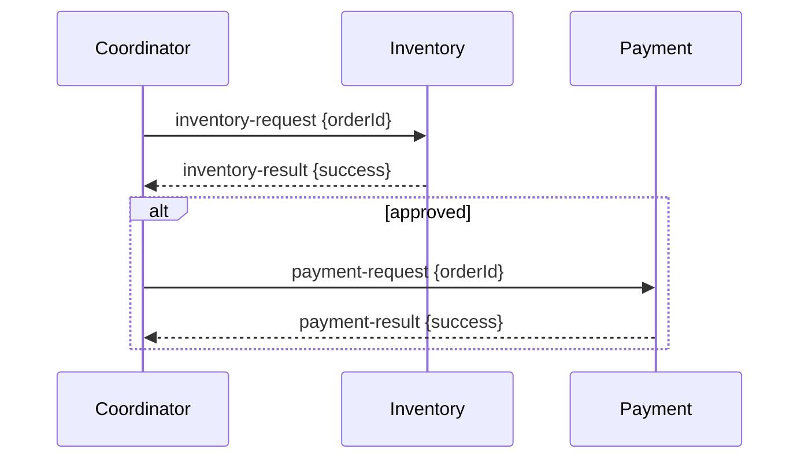
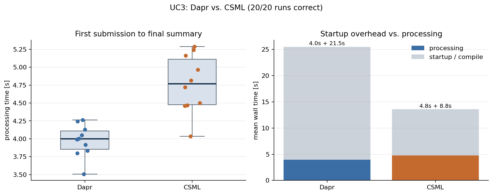

# EX06 – Programming Abstractions: Distributed Order Processing (UC3)

**Student Name:** David Mairhofer  
**Student ID:** `csbc2382`

---

## to build and run

UC3:

- 1 order coordinator
- 1 inventory service
- 1 payment service

Both versions implement the same protocol: the coordinator submits `Order 1`–`Order 6`, inventory rejects `Order 3`, payment rejects `Order 5`, and the other four orders complete.

Prerequisites: JDK 21+, Maven, Docker, the Dapr CLI 1.19.1, and Python 3 with `matplotlib` for the plot. If Dapr is not installed:

```bash
curl -fsSL https://raw.githubusercontent.com/dapr/cli/master/install/install.sh | sh
dapr init --runtime-version 1.19.1
```

CSML (etcd + Zenoh router + three Cirrina containers):

```bash
cd ex06/dm/csml/config
docker compose up --abort-on-container-exit --exit-code-from coordinator
# ctrl+c
docker compose down          # also clears etcd (there is no volume)
# or for testing I often did/copied this:
docker compose down # clean up
docker compose up -d --force-recreate # detached; more convenient imo
docker compose logs -f coordinator inventory payment | grep -E 'coordinator|inventory|payment'
```

Dapr (three JVMs, each with its own sidecar):

```bash
cd ex06/dm/dapr
export PATH="$PWD/../../.work/dapr/bin:$PATH"   # only if the CLI is installed there
./run.sh # CLARIFICATION: script was written with the help of an LLM!
```

`run.sh` starts inventory (3501/50002) and payment (3502/50003), waits 10 s, then starts the coordinator (3500/50001). this is to ensure that they subscribe before the coordinator publishes stuff; didn't notice that race-condition at first...

The coordinator exits after printing the summary; the script then kills the two long-lived services.

Reproduce the measurements:

```bash
cd ex06/dm
./run_experiment.py 10      # results/results.csv + results/logs/
./plot.py                   # experiment.png
```

## Implementation



**Dapr**

- 3 Kotlin mains; `DaprClient` for state + pub/sub
- state key `orders`; topics: `inventory-request`, `inventory-result`, `payment-request`, `payment-result`
- subscribe before submit; single lock; ignore stale/duplicate results
- `Mono.delay(300–800 ms)` + `concatMap`: serializes requests, no explicit queue

```kotlin
val resultSubscription = startResultSubscriptions()
Thread.sleep(500)
submitAllOrders()
awaitAllOrders()
```

**CSML**

- one [`uc3.pkl`](csml/src/uc3.pkl): 3 state machines + 3 instances
- every container loads the same file
- selected via `RUN=coordinator|inventory|payment`
- `orders` persistent; per-service queues transient
- 300–800 ms via `Timeout`; `always` transition drains the next request if queue not empty
- persistent map: whole-map assignment only
    - I tried `orders['Order 1'] = 'CHECKING'` but `orders` just receives/gives you a local copy of the persisten map; so `[...] = ...` just wrote into the local copy, not the persistent one; was really annoying to find and debug

> (CLARIFICATION: the Kotlin skeleton, some CSML cleanup (as I had a lot of duplicate copy pasted code) and the experiment scripts were LLM-assisted. I filled in the order logic, reviewed the result and ran all experiments.)

## Task results

Both implementations produced the required result in every run:

| Order | Dapr | CSML |
|:--|:--|:--|
| Order 1 | COMPLETED | COMPLETED |
| Order 2 | COMPLETED | COMPLETED |
| Order 3 | REJECTED (inventory) | REJECTED (inventory) |
| Order 4 | COMPLETED | COMPLETED |
| Order 5 | REJECTED (payment) | REJECTED (payment) |
| Order 6 | COMPLETED | COMPLETED |

Order 3 never reaches payment.

| Metric | Dapr | CSML |
|:--|--:|--:|
| Logical source lines (non-blank, non-comment) | 236 | 214 |
| `config/` lines | 24 | 87 |
| `pom.xml` + run scripts lines | 95 | 3 |
| Active coding time (Simple Coding Insights) | 43 min | 65 min |
| Compilation/configuration errors hit (approx.) | 2 | 5 |

> (CLARIFICATION: CodeTime was not used because it requires an online login. I used the local Simple Coding Insights extension instead. The Kotlin time excludes the LLM assistance I received, so 43 min is a lower bound. Also the CSML+Dapr learning & playing around time is a lot longer (~5h))

[`run_experiment.py`](run_experiment.py) runs each version 10 times and records the time from the first order submission to the final summary, so compilation and container startup are excluded. The right panel of the plot shows startup separately.

| Framework | Correct runs | Processing median (range) | Mean startup | Mean wall |
|:--|--:|--:|--:|--:|
| Dapr | 10/10 | 4.00 s (3.51–4.26 s) | 21.52 s | 26.21 s |
| CSML | 10/10 | 4.77 s (4.03–5.29 s) | 8.81 s | 25.31 s |

Dapr processes the six orders about 0.8 s faster (median), but CSML starts about 12.7 s faster; end-to-end wall time is therefore almost equal (CSML about 0.9 s faster on mean).



## Discussion Questions

> How did the amount of infrastructure boilerplate code differ between Dapr and CSML?

- Dapr: three app mains, three sidecars, component YAML, explicit state keys, publish calls, subscriptions
- CSML: one `uc3.pkl` + Compose file; runtime handles routing, state and timeouts
- CSML: far less boilerplate; Dapr: more code, but language-native

> How does CSM's hierarchical data scoping (persistent vs. transient data) compare to explicitly managing state keys in Dapr?

- CSML: `persistent` = shared/etcd, `transient` = per instance, `static` = per state
- Dapr: one flat KV namespace; as I had a single writer&reader it was simple (no coordination); otherwise I'd have needed data versioning (like last week) to ensure consistency
- CSML removes key management

> Which programming model felt more natural for expressing cross-component coordination, and why?

- CSML: order lifecycle maps directly to states/events; transition table reads like the protocol
- Dapr/Kotlin: easier for arbitrary logic and debugging, but more plumbing
- For this use case imo: CSML

> Based on your CodeTime logs, which implementation required less active coding time, and where did you spend most of your debugging effort?

- Dapr 43 min vs. CSML 65 min (Simple Coding Insights, not CodeTime); i did CSML first
- CSML debugging: request queueing + persistent-map write-back (main blocker)
- Dapr debugging: subscribe-before-publish + reactive delays

> What were the main difficulties encountered when implementing your assigned use case in each framework?

- CSML: silent ignored events (if mistyped or not handled by the current active state), map-copy semantics, `always` list syntax, array vs. `ArrayList`
- Dapr: no replay, at-least-once duplicates (LLM said this could happen), immutable state, `Thread.sleep`, three port pairs (but only because I executed all 3 on the same device)
- Both: startup order and configuration friction

## Problems I ran into

- CSML persistent map: `orders[key] = ...` mutated only the deserialized copy; whole-map assignment fixed it — main blocker.
- CSML queueing: one request at a time; the next five were ignored while `checking`/`charging`; transient `ArrayList` + `always` fixed it.
- CSML `always`: list of transitions; needs `new Transition { ... }`, else Pkl `Listing` error.
- CSML `[]`: Java array; `.add` fails; use `new('java.util.ArrayList')`.
- Dapr pub/sub: Redis has no replay; subscribe before publishing + 500 ms wait.
- Dapr state: `State.getValue()` is read-only; `toMutableMap()`; coordinator as single writer.
- Dapr delays: `Thread.sleep` blocks the Reactor thread; `Mono.delay().then()` + `concatMap`.
- Dapr ports: three sidecars need three HTTP/gRPC port pairs.
- Docker mounts: `:z` needed on Fedora; else `ZError: Permission denied`.
- etcd noise: `GOAWAY ... too_many_pings` after ~90 s; harmless keepalive backoff.

## Notes

All three CSML containers need the same `uc3.pkl`; otherwise cross-container events are dropped; duplicate init warnings (for the persistent data) are harmless