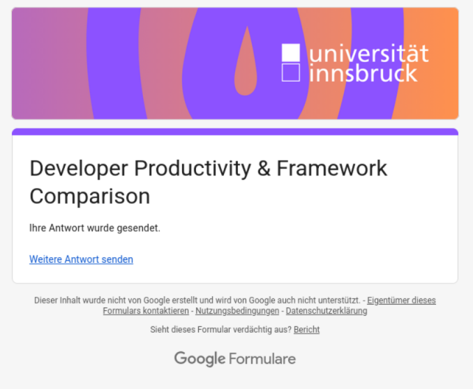

# Ex06 

## Task 1

The boilerplate, run.sh and config was generated by Opus 5.5, logic was done by me.

The Manager first creates the ressources and then subscribes to `REQUEST` and `RELEASE` events from the client.
On request it checks if a ressource is available, if yes it grants the request, else it puts the request in a queue.
If a resource is released, the manager checks the queue if there is a pending request, if yes it grants it, else it just sets the resource to available.

The Client first sends the 2 requests, and if a request is granted it waits a random time between 500 and 1500 ms and then publishes the `RELEASE` event.

It took me 66 minutes of active coding time.

Logical Lines Of Code: 174
Logical Lines Of Code (Config): 24

### Notes

There is a lot of boilerplate that needs to be written before getting started with the actual logic, but after that pretty straight forward and easy to debug.

## Task 2
Config and run.sh script was generated by Opus 5.5 as well as some debugging.

### Implementation
- Persistent Data: ressources and requests, they are always reassigned as a whole map
- Transient Data: The manager has the pending Queue, which is an `ArrayList` of maps. Here I was not quite sure on what datatypes i can actually use so I just looked at the source of my colleague David Mairhofer.
- On Request: the manager grants the free resource or it queues the request if none is available
- On Release: the manager frees the resource and marks the request as completed. If there is a pending request, it gives said request the resource. Once all requests are completed it moves to the done state and prints the final message.
- Clients: each one sends its first request, and only after the first request is done sends the second.

### Notes 
There were 2 major pitfalls which took me a bit of time, before caving in and asking an LLM for help: 
1. I tried to mirror the structure of the dapr version, in sending both requests from the client, the problem was if a grant came in while the other grand was being handled, the new one was silently dropped. The fix is easy, simply sending the second request after the first is done, but debugging not so much.
2. The case analysis maches all possible cases and not only the first possible, so it would grant both resources to a single request. So I had to explicitly write out the cases so only one can be true.

The data model was also a bit confusing especially how to work with actual datatypes like ArrayList

In general I think it is very easy to read and follow the code of the csm, but writing feels a bit unusual, since this highly declarative style isn't something I have much experience with.

It took me about 87 minutes of active coding time. But with debugging and doc reading probably 1-2 hours more

Logical Lines of Code: 132
Logical Lines of Code (config): 101

## Task 3

> How did the amount of infrastructure boilerplate code differ between Dapr and CSML?
Dapr needed more java boilerplate, while csml needed more config w.r.t. docker.

> How does CSM's hierarchical data scoping (persistent vs. transient data) compare to explicitly managing state keys in Dapr?

In CSM I could easily differentiate between scoping for global, per machine, per state.
In dapr since the use case was really simple, the manager just had the state and was the only one really writing and reading from it.

> Which programming model felt more natural for expressing cross-component coordination, and why?

CSML reflects the step by step relations to the task well, while dapr is just more familiar if you know how to program.

> Based on your CodeTime logs, which implementation required less active coding time, and where did you spend most of your debugging effort?

CSML took about 20 minutes longer of active coding time and about an hour longer if taken into account the learning and debugging. Again mainly because it is kind of unfamiliar.

> What were the main difficulties encountered when implementing your assigned use case in each framework?

CSML: Learning the new model, datatypes, ignored events, debugging
Dapr: Boilerplate, understanding the architecture

